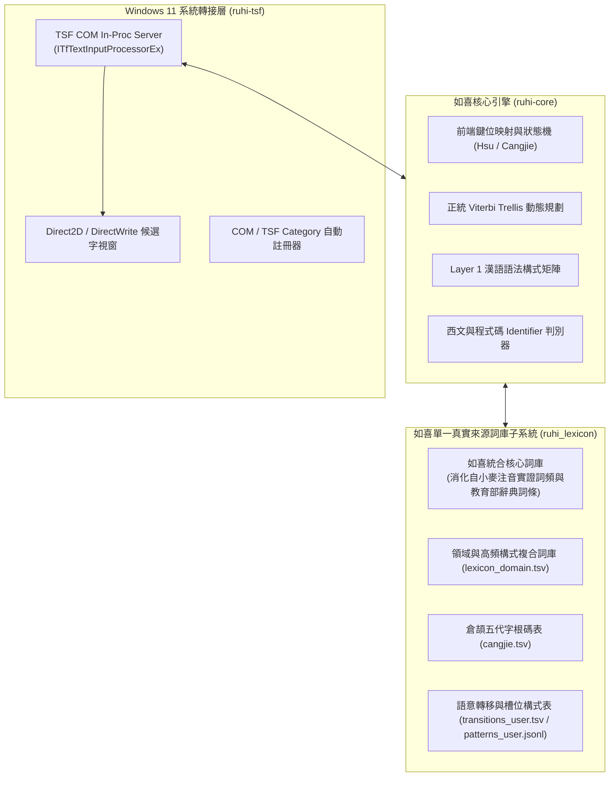

<div align="center">

# 🌸 如喜（RuhI）通用智慧型輸入法
### Responsive Universal Human Input — Written in 100% Pure Rust

> **「如雲行水流自在歡喜 —— 再也不必望穿秋水，等候一個可能永遠不會進步的官方詞庫。」**  
> **RuhI**（**R**esponsive **U**niversal **H**uman **I**nput，梵語字根 *Ruh / Rūhi* 意為「萌芽、生長、向上攀升」），是一款面向 Windows 10/11 與 Linux、完全採用純 Rust 打造的次世代自適應通用人本輸入法與語意調校系統。

[]()
[](https://www.rust-lang.org/)
[-blue.svg)]()
[](LICENSE)
[]()
[](https://line.me/ti/g2/iyLVoHye-Ho49K9SzQBaftTgFzej7stw9S1jSw?utm_source=invitation&utm_medium=link_copy&utm_campaign=default)

</div>

---

## ✨ 10 秒一眼看懂：如喜輸入法有什麼不一樣？

傳統輸入法常讓人陷入兩難：**打注音／拼音時，遇到不會念的生僻字就卡住；打倉頡／字形碼時，又得死背複雜的字根表，而且不同輸入法之間切換繁瑣、各打各的。**

**如喜（RuhI）通用智慧型輸入法** 把最常用的各種輸入方式整合進**同一個智慧輸入座**，並在 `v0.7.0` 帶來兩大突破：

### 1. 🐉 整合創新「龍龕形音輸入法」—— 免背字根，看外型或念偏旁就能打出任何漢字
> **龍龕以形聲結構（形符＋聲符讀音）為核心，相容注音雙拼與漢語拼音，免切換模式即可以部件讀音組字，並提供輸入座內的事後部件融合。**  
> 📄 **技術公開文件**：[DOI 10.5281/zenodo.23751480](https://doi.org/10.5281/zenodo.23751480)（版本 DOI：[10.5281/zenodo.23751481](https://doi.org/10.5281/zenodo.23751481)，[`docs/RUHI_LONGKAN_TECHNICAL_DISCLOSURE.md`](docs/RUHI_LONGKAN_TECHNICAL_DISCLOSURE.md)）

* **(a) 完全不懂漢字的外國人，可以用「英文字母外型」拼湊出漢字**：
  * 不用會念中文、也不用背字根，**看到漢字長得像哪個英文字母就打哪個字母**！
  * 例如：
    * 方框像 `O`（口）＋ 直線像 `I`（丨）➔ 打 **`OI`** 就是 **「中」**
    * 三個方框疊在一起 ➔ 打 **`OOO`** 就是 **「品」**
    * 十字像 `T`（十）＋ 方框像 `O`（口）➔ 打 **`TO`** 就是 **「古」**
    * 左邊日曆格像 `B`（日）＋ 右邊彎月像 `D`（月）➔ 打 **`BD`**（或 `BODE`）就是 **「明」**
    * 外框像 `C`（匚）＋ 裡面三個口 `OOO` ➔ 打 **`COOO`** 就是 **「區」**
* **(b) 完全支援「有邊讀邊、沒邊念中間」—— 把看得懂的漢字部件發音直接組合成字**：
  * 遇到忘記讀音或不會念的漢字，只要把字拆開、**念出看得懂的偏旁或部件發音**，就能組合成字（同時支援注音雙拼與羅馬拼音）！
  * 例如：
    * 想打 **「鋪」**：打 **「金 ＋ 甫」** 的發音（`jnfx` 或 `kmfu` / `jinfu`）
    * 想打 **「龕」**：打 **「合 ＋ 龍」** 的發音（`hgln` 或 `helo` / `helong`）
    * 想打 **「謝」**：打 **「言 ＋ 身 ＋ 寸」** 的發音（`emcnam` 或 `yanshencun`）
    * 想打 **「看」**：手搭在眼睛上，打 **「手 ＋ 目」** 的發音（`comx` 或 `shoumu`）
    * 想打 **「森 / 晶 / 淼 / 鑫」**：三個相同的部件，直接連打三次（如三個木 `mxmxmx` / `mumumu`，或直接打「部件＋數字」`mu3` = 森、`ri3` = 晶、`ko3` = 品）。
  * **萬一不小心把合體字拆成兩個字打出來怎麼辦？**
    只要在輸入座裡按 **`Shift + ←`** 把剛打出的「合龍」或「日月」框起來，按一下 **`Tab` 鍵**，輸入座就會當場把兩個部件融合成 **「龕」** 或 **「明」**！
* **(c) 相關前案與整合創新差異（Prior Art & Differentiation）**：
  * 中文輸入法歷史上已有諸多優秀前輩探索「字形」與「字音」結合的可能性：
    1. **嘸蝦米輸入法（劉重次先生，1989）**：開創以英文字母「形、音、義」聯想記憶字根之先河（如 `O` 像口、`B` 像日），但仍須記憶一套專屬字根表與拆字取碼規則。
    2. **自然碼／小鶴音形等雙拼「音形碼」**：採用「整字讀音雙拼（前 2 碼）＋ 部首／筆畫輔助碼（後 2 碼）」架構，前提是使用者**必須先知道整個字的正確讀音**，遇到不會念的字即無法起手。
    3. **搜狗拼音 `u` 模式／微軟拼音 `u` 拆字模式**：提供以 `u` 引導後輸入兩個部件全拼的臨時查字附屬工具（如 `ujinfu` 查「鋪」），但不支援許氏雙拼、不支援英文字母視覺象形直打，亦非獨立的定長連打主力輸入法。
  * **如喜「龍龕形音輸入法」的整合創新定位**：將**① 英文字母視覺象形直打（免背字根表）**、**② 部件讀音組合（免知整字讀音，並聯相容許氏雙拼、漢語拼音與台羅入聲雙拼）**、**③ `部件 × 數字` 結構代數（$C \times N$）** 與 **④ 輸入座內 `Shift+← + Tab` 事後部件融合** 四大機制整合於同一套零模式切換的編碼空間中，讓外語學習者與母語使用者皆能以直覺拆解輸入。

### 2. 🔄 各輸入模組在「同一個輸入座」中滑順交互支援
如喜內建 **許氏雙拼、標準大千、倚天 26 鍵、龍龕形音、智慧四角號碼（九宮格小鍵盤）、行列 30、倉頡、日文羅馬字、韓文羅馬拼音與英數歐文**。所有模組不是各自孤立的工具，而是在同一個輸入座中彼此無縫支援：
* **單按 `` ` ``（反引號）—— 臨時借用另一種輸入法打「單一字／詞」，打完自動返回**：
  * 例如您平常習慣打注音，打長句到一半突然遇到一個讀不出來的字，只要按一下 **`` ` ``**，直接用龍龕（或您設定的輔助輸入法）打出該字或詞，**送出瞬間自動切回原本的注音**，整句話留在同一個輸入座完全不中斷！
* **單按 `~`（波浪號）—— 主力與輔助輸入法一鍵雙向切換**：
  * 按一下 **`~`** 立即切換至您指定的第二輸入法（如日文、韓文或龍龕），持續輸入直到**再次按下 `~`** 即刻回到原輸入法。
* **配合 `Caps Lock` 達成「一主二輔」極速切換與自訂排序**：
  * 單按 **`Caps Lock`** 在最後兩種模式間快速對切（且與 `~` 互不干擾，輕鬆掌控一種主要輸入法＋兩種輔助輸入法）。
  * 按 **`Ctrl + Caps Lock`**（往後）與 **`Shift + Caps Lock`**（往前）可在三種以上輸入法間循環切換，並支援於偏好設定中心**手動調整排序（▲上移／▼下移）**。
* **連按兩下 `` `` `` 與 `~~` 隨手快打**：
  * 連按兩下 **`` ` `` × 2**：立即展開 **📋 使用者自訂文字範本**（常用簽名、地址、西元／民國日期）。
  * 連按兩下 **`~` × 2**：立即進入 **🔢 數字快打模式**（輸入 `12345` 即時轉為「一萬二千三百四十五」、「壹萬貳仟參佰肆拾伍圓整」、「NT$12,345」）。

### 3. 🧠 唯一全面從「計算語言學與漢語語法構式」切入的智慧選字（打字當下零 AI 延遲、拒絕單字權重打地鼠）
目前市面上或社群開發中的新世代注音輸入法，多半走兩條路線：一是沿用傳統純統計詞頻（一旦改動單字權重就陷入「越調越壞」的打地鼠窘境），二是在打字當下直接呼叫大型語言模型（AI）即時猜字（伴隨聯網需求、高顯卡記憶體消耗、數百毫秒延遲，甚至同一串注音每次打出不同結果）。

**如喜注音從誕生之初，便選擇了獨樹一幟的第三條正道——全面從「形式語言學與漢語構式語法」切入：**
* **打字當下 100% 語言學結構解碼（毫秒級確定性反應、零顯卡負擔）**：將中央研究院《漢語知識標記語料庫（Sinica Corpus）》動詞論元結構、呂叔湘《現代漢語八百詞》虛詞呼應網、Li & Thompson 準分裂句焦點構式，化為引擎內建的 **多維語法槽位陣列（$A_{\text{array}} \times B_{\text{array}}$）**。引擎是因為真正理解漢語的「詞類、主謂賓搭配與句法構式」，才能在毫秒間精準分辨「在／再」、「的／得／地」、「心裡／心理」、「小時候／兩小時後」、「戴口罩／帶口罩」、「權利／權力」、「買的是／買的試」等二十餘組同音難題。
* **AI 是幕後的「語言學分析師」，而非前台搶方向盤的打字員**：只有當使用者在 `ruhi-studio` 語意調校工作室回報新型同音盲點時，才在幕後透過神經符號引擎與 AI 語意分析師將問題提煉為**可解釋、可舉一反三的形式化語法構式規則**，並經過記憶體內 **Viterbi 三重零迴歸沙盒** 驗證後寫入詞庫，讓日常打字永遠保持純粹、極速與 100% 可預期。
* **7 合 1 跨輸入法反查教練**：想邊打注音邊學龍龕、四角號碼、行列 30 或倉頡？可在輸入座開啟即時反查提示，或一鍵開啟 [🎬 4K 跨輸入法互動查碼與拆碼教學工作台](docs/ruhi_interactive_workbench.html)，輸入整串句子即可同屏對照七種輸入法的拆解步驟。

---

## 🔧 工程架構與技術深潛 (Technical Architecture & Deep Dive)

### 1. 🦀 純 Rust Windows 11 原生 TSF COM 架構
* **拋棄古老 C++ 包袱**：全面基於現代 Rust 與官方 `windows-rs` 實現完整的 Windows Text Services Framework (TSF) COM In-Proc 伺服器。
* **安全、極速、零外洩**：記憶體安全保障，杜絕常年困擾輸入法的焦點卡死與記憶體洩漏；全本地計算，100% 捍衛擊鍵隱私；內建 Win32 密碼控制項（`ES_PASSWORD` / `EM_GETPASSWORDCHAR`）與現代 TSF `GUID_PROP_INPUTSCOPE`（`IS_PASSWORD` / `IS_PIN`）雙軌密碼欄偵測，聚焦密碼欄時自動放行英數直通且絕不記錄修訂日誌。
* **全生態 Win32 深入相容**：零 ComCtl32 v6 靜態依賴，自動適配 LibreOffice、命令提示字元 `conhost.exe` 與現代 UWP / AppContainer 應用程式。

### 2. ⚡ 多元輸入引擎技術規格（許氏雙拼、龍龕形音、四角號碼九宮格、倉頡／行列 30 與日韓歐文）
* **音節有限狀態機 (FSM)**：針對許氏雙拼、標準大千與倚天 26 鍵配列進行精緻化鍵位建模，實現流暢的長句直出與音節即時切分。
* **如喜・龍龕形音輸入法 (`LongkanEngine`，模式代碼 `longkan`／徽章 `龍`，v0.7.0 整合創新推出)**：
  * **致敬公元 997 年行均法師《龍龕手鑑》之「形音合流」整合創新架構**：基於純 Unicode Unihan (`Unicode License v3`) 與原創部件表建置，經 `scripts/longkan_stats.py`（`2026-10-29`）實測統計：碼表共 **356,536 筆**（涵蓋 **187,997 組不重複編碼**、**13,000 個單字**、**42,002 組多字詞**；每單字平均 **17.57 組相容碼**，中位數 15、P90 29、P99 45；單字編碼熵加權 **16.38 bits**／等權 **16.42 bits**；單字不加權唯一率 **56.62%**／字頻加權唯一率 **23.23%**；二字詞不加權唯一率 **64.07%**／加權 **33.06%**；全體多字詞不加權唯一率 **88.87%**／加權 **75.91%**；前 3,000 常用單字首選可達率 **96.77%**，`ruhi_eval --mode longkan` 實測單字首選命中率 **84.43%**、前 5 候選命中率 **99.32%**、KSPC **5.00**），並編譯為 `RLKB0001` 唯讀作業系統記憶體映射檔（`longkan.bin`, **29.64 MB**，首次映射載入 **0.14 ms**）：
    1. **軌跡 A（部首／部件讀音組合）**：完整支援「有邊讀邊、沒邊念中間」，並聯許氏雙拼、漢語拼音與歷史入聲雙拼——如 `鋪 = 金(jn/km/jin) + 甫(fx/fu)`、`龕 = 合(hg/ho/he) + 龍(ln/lxl/long)`、`謝 = 言(em/yan) + 身(cn/shen) + 寸(am/cun)`。
    2. **軌跡 B（英文字母視覺象形 ＋ 部件讀音 ＋ 空白鍵／聲調補碼 `12345`/`dfjs`）**：專為外國學習者與直覺拆字設計——如 `中 = 口(o) + 丨(i) ➔ oi`、`古 = 十(t/ti) + 口(o) ➔ to / tio`、`明 = 日(b/bo) + 月(d/de) ➔ bd / bode`、`肴 = 乂(x) + 有(eo) ➔ xeo`。
    3. **軌跡 C（`部件 × 數字` 疊字結構代數 $C \times N$ 與疊音連打）**：如 `區 = 匚(c) + 口(ko)×3 ➔ cko3 / cooo`、`品 = 口(ko)×3 ➔ ko3 / kokoko / ooo`、`森 = 木(mu)×3 ➔ mu3 / mxmxmx / ttt`、`晶 = 日(ri)×3 ➔ ri3 / rrr`。
    4. **軌跡 D（`Tab` 或 `-` 多字詞簡碼與輸入座 `Shift+← + Tab` 事後拆字融合）**：支援二字詞 4 碼（`首前2 + 尾後2`）與三字以上多字詞簡碼（`首前2 + 中1 + 尾後2`，最多 6 碼），以及在輸入座內將已拆打之部件即時融合成單一合體字。
* **如喜智慧型四角號碼輸入法 (`FourCornerEngine`，v0.6.0 推出)**：
  * **104 鍵盤「九宮格編碼 × 主鍵盤直出英數」雙區平行免切換**：右側九宮格小鍵盤（`0`~`9`、`/`、`*`、`.`、`-`、`+`）專責四角漢字編碼與選單控制，左側主鍵盤區保持免切換直出一般英數字與半形符號，中英數混打零模式切換！
  * **「單字 `XXXX`」與「`-` 詞前導 `-XXXX / -XXXXX / -XXXXXX`」零碰撞分流**：內建 76,299 筆三軌相容碼表（涵蓋 17,491 單字之 Unihan 標準碼、台灣正異體雙向共享、初學者免補 `0` 直覺寬容碼，以及 34,305 組二字詞 `-XXXX`、三字詞 `-XXXXX`、四字成語 `-XXXXXX` 簡碼矩陣）。
  * **人體工學小鍵盤控制**：`/` 字詞選單（`1`~`0` 快選）、`*` 萬用字元、`.` 標點符號選單（3 頁 30 種常用標點，連按 `..` 直出逗號）、`-` 詞前導（選單中翻上一頁）、`+` 字詞分隔收攏至輸入座（選單中翻下一頁）、`Enter` 整句完稿上屏，並附帶 [4K 自適應跨輸入法互動查碼與拆碼教學工作台](docs/ruhi_interactive_workbench.html)。
* **通用可擴展跨輸入法反查教練（`reverse_coach`，v0.7.0 升級為 7 合 1）**：基於開放封閉原則之 [`ReverseLookupProvider`](ruhi-core/src/reverse_coach.rs) 架構，支援**龍龕形音 (4碼)**、**智慧四角號碼 (4×5)**、**行列 30 (筆形座標)**、**倉頡五代 (哲理字根)**、**許氏雙拼**、**標準大千**與**倚天 26 鍵**七大方案 $N \times M$ 雙向對照反查；既可於視覺化互動工作台同屏比對整串句子之各方案拆碼，亦可在懸浮輸入座自由指定任一目標輸入法即時反查。
* **輕量級日文羅馬字 (`JapaneseEngine`) 與韓文標準羅馬拼音 (`KoreanEngine`)**：免切換安裝多套輸入法，原生支援日文平／片假名漢字轉換與韓文 Revised Romanization (RR) 11,172 音節代數合成。
* **跨輸入法通用交互切換（`Caps Lock` ／ `` ` `` ／ `~`）**：`Caps Lock` 一鍵快速對切最後兩個輸入模式；单按 `` ` `` 臨時借用輔助輸入法打單一字／詞後即刻返回；單按 `~` 雙向切換輔助輸入法；`Ctrl+Caps Lock` / `Shift+Caps Lock` 依使用者自訂排序循環切換。

### 3. 🎯 歐亞雙軌上下方向鍵按需預測（零日常打字干擾）
* **`↓` 下方向鍵**：歐文模式自動展開多語系帶重音變音正字（`naive` ➔ `naïve`、`strasse` ➔ `Straße`）；日文模式展開平片假名與漢字候選。
* **`↑` 上方向鍵**：注音支援前綴聲母頭碼快打（如 `ㄒㄆㄑㄏ` ➔ `心平氣和`）與上文搭配語境救援（`胸有` ➔ `成竹`）；歐文模式支援長單字補全與 Levenshtein 拼寫模糊救援。

### 4. 🧠 計算語言學正道：拒絕「單字權重打地鼠」
* **結合上下文回溯之詞網格束搜尋 (Context-Aware Lattice Beam Search)**：於動態規劃詞網格上保留多路徑假設與跨距回溯，守護合法長詞凝聚力，杜絕貪婪切碎。
* **Layer 1 漢語語法構式矩陣（十九大形式化構式體系）**：系統性實作中央研究院「漢語知識標記語料庫（Sinica Corpus）」動詞論元結構矩陣（`VE` 句賓動詞、`VF` 謂賓動詞、`VD` 雙賓動詞）、呂叔湘《現代漢語八百詞》微觀虛詞關聯呼應網、Li & Thompson《漢語語法》話題與準分裂句焦點構式（`(不)X 的 是`），以及二十一組現代漢語高頻同音易混字組（`C01`～`C21`，涵蓋「再/在」、「得/的/地」、「已/以…為由」、「小時候/兩小時後」、「必須/必需品」、「戴口罩/帶口罩」、「嗎/嘛」、「心裡/心理」、「反映/反應」、「權利/權力」、「紀錄/記錄」、「走進/走近」等）雙向語境分流，徹底根絕傳統輸入法隨意亂調單字權重導致的系統性崩潰。
* **辭典治理雙帳本契約 (`rejected_readings.tsv` & `reachability.tsv`)**：建立永久黑名單帳本（攔截古籍罕用破音與語料殘片）與可達性迴歸契約帳本（確保核心構式詞與台灣政府資料開放平臺 OGDL 1.0 專有名詞 100% 可檢索），由自動化單元測試嚴格把關。

### 5. 🛠️ 語意調校（Semantic Tuning）三層分級與神經符號沙盒架構
為兼顧一般使用者的純淨穩定體驗與進階語意演化需求，`ruhi-studio` 實作了嚴謹的**三層分級語意調校架構**：
* **Lv.1 一般使用者純享模式（預設）**：隱藏複雜調校面板，絕不於本地端盲目自動改動詞庫權重（杜絕傳統輸入法越打越亂的語意污染）；使用者在明確勾選同意（Opt-In）後，可透過 `ZeroPiiPrivacyFilter` 啟發式個資過濾閘門匿名回傳「錯誤句與修正後正確句」對照，並透過 **Tailcat 雲端語意同步** 自動接收官方驗證後之最新構式與詞庫。
* **Lv.2 進階專家沙盒模式（記憶體內 Viterbi 三重零迴歸驗證）**：開放本地語意調校工作室，內建**確定性神經符號計算語言學引擎（BiMM+LCS 雙向詞界對齊 ＋ 舉一反三槽位陣列提煉）**。所有提煉之規則均須先在記憶體內通過 **Viterbi 三重零迴歸沙盒 (`verify_rules_in_viterbi_sandbox`)**——同時驗證「目標錯句成功修復」、「同音對抗反例零誤傷（Type A/B/C 三路分流）」與「黃金基準測試集 100% 零迴歸」，並強制攔截任何企圖修改單字全域先驗權重（`UNIGRAM_WEIGHT`）之規則，通過後方可寫入個人層並支援一鍵還原。
* **Lv.3 核心總工程師模式（Google Gemini 雲端顧問 ＆ Google Colab A100 特化微調 Gemma 4 語意分析師）**：支援直接對接 Google Gemini API（僅需數 KB JSON 傳輸），並建立 **Google Colab AI Ultra (A100) 自動化 QLoRA 微調管線**（以如喜黃金構式與對抗反例集特化訓練 `google/gemma-4-e4b-it` 漢語語意分析師模型，每累積滿 5 條新構式即可一鍵觸發雲端特訓與權重回傳；本地端 `.gguf` 推論全面採用**純綠免安裝版 `llama.cpp` (`llama-server.exe`)** 按需喚醒、隨關隨放，拒絕帶有商業訂閱誘導與背景常駐之第三方包裝器）。

### 6. 🔥 1 秒極速免登出熱重載 (Hot Reload)
* **革命性開發體驗**：利用 Windows NTFS 檔案系統指標特性，提供獨創的 `hot_reload.ps1`。編譯完成後，一鍵 1 秒內完成鎖定 DLL 替換與 TSF 重新喚醒，**徹底免去登出或重開機的煎熬**！

---

## 🏗️ 系統架構概覽 (Architecture)



---

## 📂 儲存庫結構導覽 (Repository Layout)

```text
ruhi/
├── .github/workflows/    # GitHub Actions CI 與自動發布流水線
├── assets/               # 品牌圖示 (ICON.svg, ruhi.ico) 與許氏鍵盤配置表
├── docs/                 # 系統架構規範、多語擴充指南與演進里程碑
├── installer/            # Inno Setup 官方安裝包腳本與預設組態範本
├── ruhi-core/            # [Rust] 語言學核心引擎 (FSM, Trellis, Constructions, Lexicon)
├── ruhi-studio/          # [Rust] 偏好設定中心與語意調校工作室
├── ruhi-tsf/             # [Rust] Windows 10/11 原生 TSF COM 伺服器 (ruhi_tsf.dll)
├── ruhi_lexicon/         # 單一真實來源標準詞庫與語法轉移資料表 (data/*.tsv)
├── scripts/              # 原生 UTF-8 BOM 安裝、解除安裝與 1 秒免登出熱更新腳本
├── CHANGELOG.md          # 版本更新日誌
├── CONTRIBUTING.md       # 開源社群貢獻指引與嚴禁打地鼠守則
├── LICENSE               # Apache License 2.0
├── README.md             # 專案總覽
└── THIRD_PARTY_LICENSES.md # 第三方語料授權與教育部辭典聲明
```

---

## ⚡ 快速開始 (Quick Start)

### 綠色免安裝即時體驗
如果您不想在系統中全域安裝，可直接使用免安裝測試腳本：
1. 進入 `scripts/` 目錄。
2. 以一般權限右鍵點擊或在 PowerShell 中執行：
   ```powershell
   .\scripts\免安裝即時測試.ps1
   ```
3. 按下鍵盤 `Win + 空白鍵` 切換至「**如喜通用智慧型輸入法**」，立即體驗！

### 本地編譯與熱重載 (開發者)
本專案要求 **Rust 1.75+** 與 **Windows 10/11 64-bit**：

```powershell
# 1. 執行全量單元測試 (驗證核心語意與演算法邏輯)
cd ruhi-core
cargo test

# 2. 編譯生產級 Release DLL
cd ..\ruhi-tsf
cargo build --release

# 3. 執行 1 秒免登出熱重載 (自動替換並重啟文字服務)
cd ..
.\scripts\hot_reload.ps1
```

---

## 🤝 官方社群與參與貢獻 (Community & Contributing)

* **💬 加入官方 LINE 社群**：歡迎加入 [**「如喜通用智慧型輸入法」LINE 社群**](https://line.me/ti/g2/iyLVoHye-Ho49K9SzQBaftTgFzej7stw9S1jSw?utm_source=invitation&utm_medium=link_copy&utm_campaign=default)，與我們交流使用心得、回報同音選字案例、或參與新鍵盤配列與多語系擴充討論！
  * 社群邀請連結：<https://line.me/ti/g2/iyLVoHye-Ho49K9SzQBaftTgFzej7stw9S1jSw?utm_source=invitation&utm_medium=link_copy&utm_campaign=default>
* **🛠️ 開源程式碼與語意規則貢獻**：我們熱烈歡迎社群貢獻！請在提交 Pull Request 之前詳閱 [CONTRIBUTING.md](CONTRIBUTING.md)。
  特別提醒：**本專案嚴格禁止人肉調整單字無上下文權重（嚴禁單字打地鼠）**。任何詞序或語句調優，必須依循 Layer 1 語法構式或 Layer 2 轉移引力擴充，並在 `ruhi-core/src/engine.rs` 補上對應單元測試確保 `cargo test` 100% 通過。

---

## 📜 開源授權、授權範圍、詞庫統合與來源鳴謝 (License, Scope, Unified Lexicon & Acknowledgements)

### 純粹開源授權範圍 (Apache License 2.0)
* **全專案原始碼與預建置執行檔（`Apache License 2.0`）**：本專案全體原始碼（含 `ruhi-core`、`ruhi-tsf`、`ruhi-studio`、龍龕形音引擎 `ruhi-core/src/longkan/`、跨輸入法反查教練 `reverse_coach.rs` 及建置腳本 `scripts/build_longkan_tsv.py`）均以 [Apache License 2.0](LICENSE) 條款開放原始碼發布。**v0.7.0 曾宣告之專有授權已撤回，v0.7.0 及其後版本之程式碼均以 Apache License 2.0 授權。**
* **碼表與詞庫資料（`Apache License 2.0` ＋ 上游歸屬標示）**：`ruhi_lexicon/data/` 下之龍龕形音碼表（`longkan.tsv` / `longkan.bin`）、四角號碼碼表（`four_corner.tsv`）、倉頡與行列 30 碼表及統合核心詞庫，均由相容之公開授權資料集建置並以 Apache License 2.0 釋出（須保留上游資料來源標示，詳見 [THIRD_PARTY_LICENSES.md](THIRD_PARTY_LICENSES.md)）。
* **如喜單一真實來源詞庫（Single Source of Truth）**：如喜已將多源開源語料徹底清洗、正音並消化為內部統一權重尺度的自有詞庫，不再於執行期讓不同來源之合成權重與實證語料頻率相互衝突。
* **上游語料來源致謝與授權聲明**：
  * **Unicode Unihan Database (`Unihan.zip`)**（[Unicode License v3](https://www.unicode.org/copyright.html)）：提供標準部首餘筆（`kRSUnicode`）、總筆畫數（`kTotalStrokes`）、聲符（`kPhonetic`）、四角號碼（`kFourCornerCode`）與國語讀音資料。
  * **OpenVanilla / 小麥注音 (McBopomofo)**（[MIT License](https://github.com/openvanilla/McBopomofo)）：提供現代繁體中文常用詞彙與語料庫對數詞頻實證基底。
  * **g0v 零時政府萌典 (Moedict) 與中華民國教育部《重編國語辭典修訂本》**（CC0 / CC BY-ND 3.0 TW / 政府資料開放授權條款 OGDL 1.0）：提供標準台灣正體字形、成語典故與審訂讀音參考，詳見 [THIRD_PARTY_LICENSES.md](THIRD_PARTY_LICENSES.md)。
