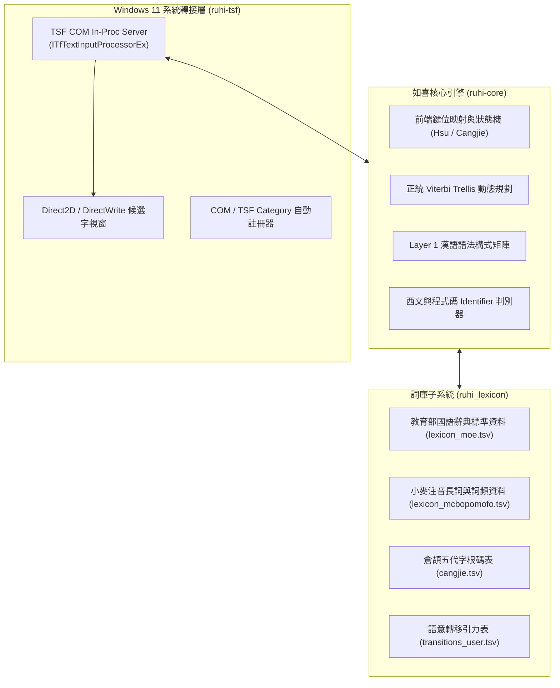

<div align="center">

# 🌸 如喜（RuhI）通用智慧型輸入法
### Universal Smart Input Method Substrate — Written in Pure Rust

> **「通天達地，行雲流水，心手合一。」**  
> 如喜（RuhI）是一款面向現代 Windows 11、完全採用純 Rust 打造的次世代原生 TSF COM 輸入法底座。

[]()
[](https://www.rust-lang.org/)
[-blue.svg)]()
[](LICENSE)
[]()

</div>

---

## 🌟 核心特色 (Key Features)

### 1. 🦀 純 Rust Windows 11 原生 TSF COM 架構
* **拋棄古老 C++ 包袱**：全面基於現代 Rust 與官方 `windows-rs` 實現完整的 Windows Text Services Framework (TSF) COM In-Proc 伺服器。
* **安全、極速、零外洩**：記憶體安全保障，杜絕常年困擾輸入法的焦點卡死與記憶體洩漏；全本地計算，100% 捍衛擊鍵隱私。
* **全生態 Win32 深入相容**：零 ComCtl32 v6 靜態依賴，自動適配 LibreOffice、命令提示字元 `conhost.exe` 與現代 UWP / AppContainer 應用程式。

### 2. ⚡ 極致許氏雙拼旗艦手感、倉頡與內建日文羅馬字
* **音節有限狀態機 (FSM)**：針對許氏雙拼配列進行精緻化鍵位建模，實現流暢的長句直出與音節即時切分。
* **倉頡五代原生支援**：無縫支援倉頡字根輸入，具備數字快速選字、`Z` 鍵萬用字元查詢與萬國歐文/英文智慧零切換。
* **輕量級日文羅馬字引擎 (`JapaneseEngine`)**：免安裝龐大日語輸入法，原生支援 Hepburn / 訓令式羅馬字轉換平假名、片假名與漢字。
* **正交雙軸切換**：`Caps Lock` 一鍵切換中西模式；`Ctrl+Caps Lock` 或點擊狀態標籤（`半 許` / `半 日`）在自選亞洲模式迴圈循環。

### 3. 🎯 歐亞雙軌上下方向鍵按需預測（零日常打字干擾）
* **`↓` 下方向鍵**：歐文模式自動展開多語系帶重音變音正字（`naive` ➔ `naïve`、`strasse` ➔ `Straße`）；日文模式展開平片假名與漢字候選。
* **`↑` 上方向鍵**：注音支援前綴聲母頭碼快打（如 `ㄒㄆㄑㄏ` ➔ `心平氣和`）與上文搭配語境救援（`胸有` ➔ `成竹`）；歐文模式支援長單字補全與 Levenshtein 拼寫模糊救援。

### 4. 🧠 計算語言學正道：拒絕「單字權重打地鼠」
* **正統 Viterbi Trellis 圖搜尋**：保留全局多路徑假設，守護合法長詞凝聚力，杜絕貪婪切碎。
* **Layer 1 漢語語法構式矩陣**：以方位後置詞（Localizers）、關聯副詞、繫詞結構與數詞單位引力為核心，徹底根絕傳統輸入法隨意亂調單字權重導致的系統性崩潰。

### 5. 🛠️ 詞庫主權全面賦權：隨附「語意調校工作室」
* **再也不必望穿秋水，等候一個可能永遠不會進步的官方詞庫**：內建雙向詞網感知與邊界吸附對齊演算法，搭配「黃金語料防回歸驗證（Zero-Regression Golden Check）」。
* **自主進化，群集共榮**：使用者在本地即可安全修復語意轉移；授權後更可透過 Tailcat 匿名網絡以群集智慧參與共同詞庫進化。

### 6. 🔥 1 秒極速免登出熱重載 (Hot Reload)
* **革命性開發體驗**：利用 Windows NTFS 檔案系統指標特性，提供獨創的 `hot_reload.ps1`。編譯完成後，一鍵 1 秒內完成鎖定 DLL 替換與 TSF 重新喚醒，**徹底免去登出或重開機的煎熬**！

---

## 🏗️ 系統架構概覽 (Architecture)



---

## 📂 儲存庫結構導覽 (Repository Layout)

```text
C:\ATGprjs\ruhi/
├── ruhi-core/            # 純 Rust 輸入法核心演算法庫 (FSM, Trellis, Router, Lexicon)
│   ├── Cargo.toml
│   └── src/              # 包含 69 項全量端到端單元測試
├── ruhi-tsf/             # 純 Rust Windows 11 TSF COM 伺服器 (ruhi_tsf.dll)
│   ├── Cargo.toml
│   └── src/              # Direct2D 候選字視窗、TSF 服務
├── ruhi_lexicon/         # 標準純淨詞庫資料
│   └── data/             # 教育部詞典、小麥注音詞庫、倉頡碼表、西文詞庫
├── scripts/              # 原生 UTF-8 BOM 交付與安裝腳本
│   ├── 一鍵安裝.ps1       # 註冊並安裝如喜至 Windows 11
│   ├── 一鍵解除安裝.ps1   # 乾淨反註冊與清理
│   └── 免安裝即時測試.ps1 # 綠色免安裝即時體驗
├── docs/                 # 系統藍圖與演進里程碑日誌
├── hot_reload.ps1        # 【開發利器】1 秒免登出熱更新腳本
├── config.json           # 預設偏好設定檔
├── user_dict.tsv         # 使用者自建詞範本
├── LICENSE               # Apache License 2.0
├── THIRD_PARTY_LICENSES  # 第三方授權與教育部辭典免責宣告
└── CONTRIBUTING.md       # 開源社群貢獻指引與嚴禁打地鼠守則
```

---

## ⚡ 快速開始 (Quick Start)

### 綠色免安裝即時體驗
如果您不想在系統中全域安裝，可直接使用免安裝測試腳本：
1. 進入 `scripts/` 目錄。
2. 以一般權限右鍵點擊或在 PowerShell 中執行：
   ```powershell
   .\scripts\免安裝即時測試.ps1
   ```
3. 按下鍵盤 `Win + 空白鍵` 切換至「**如喜通用智慧型輸入法**」，立即體驗！

### 本地編譯與熱重載 (開發者)
本專案要求 **Rust 1.75+** 與 **Windows 10/11 64-bit**：

```powershell
# 1. 執行全量單元測試 (驗證 69 項語意與演算法邏輯)
cd ruhi-core
cargo test

# 2. 編譯生產級 Release DLL
cd ..\ruhi-tsf
cargo build --release

# 3. 執行 1 秒免登出熱重載 (自動替換並重啟文字服務)
cd ..
.\hot_reload.ps1
```

---

## 🤝 參與貢獻 (Contributing)

我們熱烈歡迎社群貢獻！請在提交 Pull Request 之前詳閱 [CONTRIBUTING.md](CONTRIBUTING.md)。
特別提醒：**本專案嚴格禁止人肉調整單字無上下文權重（嚴禁單字打地鼠）**。任何詞序或語句調優，必須依循 Layer 1 語法構式或 Layer 2 轉移引力擴充，並在 `ruhi-core/src/engine.rs` 補上對應單元測試確保 `cargo test` 100% 通過。

---

## 📜 開源授權與鳴謝 (License & Acknowledgements)

* 本專案本體程式碼以 [Apache License 2.0](LICENSE) 條款開源發布。
* 詞庫與資料集整合了 **小麥注音 (McBopomofo)**（MIT License）及 **中華民國教育部公開語文資料集**（OGDL 1.0），詳見 [THIRD_PARTY_LICENSES.md](THIRD_PARTY_LICENSES.md)。
