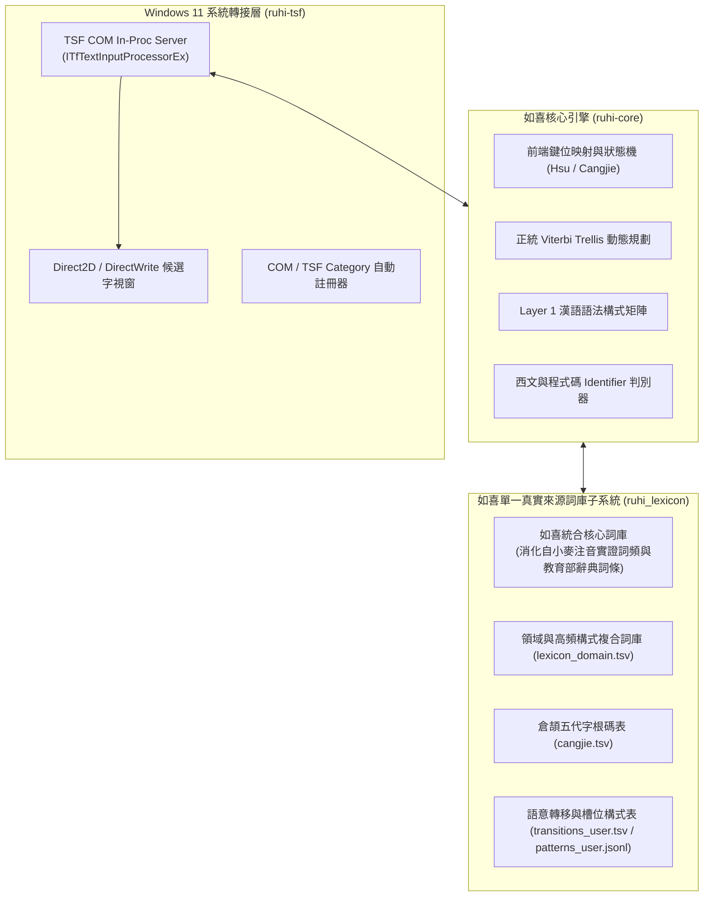

<div align="center">

# 🌸 如喜（RuhI）通用智慧型輸入法
### Responsive Universal Human Input — Written in 100% Pure Rust

> **「如雲行水流自在歡喜 —— 再也不必望穿秋水，等候一個可能永遠不會進步的官方詞庫。」**  
> **RuhI**（**R**esponsive **U**niversal **H**uman **I**nput，梵語字根 *Ruh / Rūhi* 意為「萌芽、生長、向上攀升」），是一款面向 Windows 10/11 與 Linux、完全採用純 Rust 打造的次世代自適應通用人本輸入法與語意調校系統。

[]()
[](https://www.rust-lang.org/)
[-blue.svg)]()
[](LICENSE)
[]()
[](https://line.me/ti/g2/iyLVoHye-Ho49K9SzQBaftTgFzej7stw9S1jSw?utm_source=invitation&utm_medium=link_copy&utm_campaign=default)

</div>

---

## 🌟 核心特色 (Key Features)

### 1. 🦀 純 Rust Windows 11 原生 TSF COM 架構
* **拋棄古老 C++ 包袱**：全面基於現代 Rust 與官方 `windows-rs` 實現完整的 Windows Text Services Framework (TSF) COM In-Proc 伺服器。
* **安全、極速、零外洩**：記憶體安全保障，杜絕常年困擾輸入法的焦點卡死與記憶體洩漏；全本地計算，100% 捍衛擊鍵隱私；內建 Win32 密碼控制項（`ES_PASSWORD` / `EM_GETPASSWORDCHAR`）與現代 TSF `GUID_PROP_INPUTSCOPE`（`IS_PASSWORD` / `IS_PIN`）雙軌密碼欄偵測，聚焦密碼欄時自動放行英數直通且絕不記錄修訂日誌。
* **全生態 Win32 深入相容**：零 ComCtl32 v6 靜態依賴，自動適配 LibreOffice、命令提示字元 `conhost.exe` 與現代 UWP / AppContainer 應用程式。

### 2. ⚡ 極致許氏雙拼、智慧四角號碼（九宮格小鍵盤）、倉頡／行列 30 與日韓歐文多語引擎
* **音節有限狀態機 (FSM)**：針對許氏雙拼、標準大千與倚天 26 鍵配列進行精緻化鍵位建模，實現流暢的長句直出與音節即時切分。
* **如喜智慧型四角號碼輸入法 (`FourCornerEngine`，v0.6.0 全新推出)**：
  * **104 鍵盤「九宮格編碼 × 主鍵盤直出英數」雙區平行免切換**：右側九宮格小鍵盤（`0`~`9`、`/`、`*`、`.`、`-`、`+`）專責四角漢字編碼與選單控制，左側主鍵盤區保持免切換直出一般英數字與半形符號，中英數混打零模式切換！
  * **「單字 `XXXX`」與「`-` 詞前導 `-XXXX / -XXXXX / -XXXXXX`」零碰撞分流**：內建 76,299 筆三軌相容碼表（涵蓋 17,491 單字之 Unihan 標準碼、台灣正異體雙向共享、初學者免補 `0` 直覺寬容碼，以及 34,305 組二字詞 `-XXXX`、三字詞 `-XXXXX`、四字成語 `-XXXXXX` 簡碼矩陣）。
  * **人體工學小鍵盤控制**：`/` 字詞選單（`1`~`0` 快選）、`*` 萬用字元、`.` 標點符號選單（`..` 直出逗號）、`-` 詞前導（選單中翻上一頁）、`+` 字詞分隔收攏至輸入座（選單中翻下一頁）、`Enter` 整句完稿上屏，並附帶 [4K 自適應互動拆角動畫教學與整串查碼器](docs/four_corner_tutorial_anim.html)。
* **倉頡五代與行列 30 原生支援**：無縫支援倉頡字根與行列 30 座標字根輸入，具備首尾簡碼、數字快選與許氏打字即時反查教練提示。
* **輕量級日文羅馬字 (`JapaneseEngine`) 與韓文標準羅馬拼音 (`KoreanEngine`)**：免切換安裝多套輸入法，原生支援日文平／片假名漢字轉換與韓文 Revised Romanization (RR) 11,172 音節代數合成。
* **正交雙軸切換**：`Caps Lock` 一鍵快速對切最後兩個輸入模式；`Ctrl+Caps Lock` / `Shift+Caps Lock` 或點擊狀態標籤在自選模式迴圈循環。

### 3. 🎯 歐亞雙軌上下方向鍵按需預測（零日常打字干擾）
* **`↓` 下方向鍵**：歐文模式自動展開多語系帶重音變音正字（`naive` ➔ `naïve`、`strasse` ➔ `Straße`）；日文模式展開平片假名與漢字候選。
* **`↑` 上方向鍵**：注音支援前綴聲母頭碼快打（如 `ㄒㄆㄑㄏ` ➔ `心平氣和`）與上文搭配語境救援（`胸有` ➔ `成竹`）；歐文模式支援長單字補全與 Levenshtein 拼寫模糊救援。

### 4. 🧠 計算語言學正道：拒絕「單字權重打地鼠」
* **結合上下文回溯之詞網格束搜尋 (Context-Aware Lattice Beam Search)**：於動態規劃詞網格上保留多路徑假設與跨距回溯，守護合法長詞凝聚力，杜絕貪婪切碎。
* **Layer 1 漢語語法構式矩陣（十九大形式化構式體系）**：系統性實作中央研究院「漢語知識標記語料庫（Sinica Corpus）」動詞論元結構矩陣（`VE` 句賓動詞、`VF` 謂賓動詞、`VD` 雙賓動詞）、呂叔湘《現代漢語八百詞》微觀虛詞關聯呼應網、Li & Thompson《漢語語法》話題與準分裂句焦點構式（`(不)X 的 是`），以及二十一組現代漢語高頻同音易混字組（`C01`～`C21`，涵蓋「再/在」、「得/的/地」、「已/以…為由」、「小時候/兩小時後」、「必須/必需品」、「戴口罩/帶口罩」、「嗎/嘛」、「心裡/心理」、「反映/反應」、「權利/權力」、「紀錄/記錄」、「走進/走近」等）雙向語境分流，徹底根絕傳統輸入法隨意亂調單字權重導致的系統性崩潰。
* **辭典治理雙帳本契約 (`rejected_readings.tsv` & `reachability.tsv`)**：建立永久黑名單帳本（攔截古籍罕用破音與語料殘片）與可達性迴歸契約帳本（確保核心構式詞與台灣政府資料開放平臺 OGDL 1.0 專有名詞 100% 可檢索），由自動化單元測試嚴格把關。

### 5. 🛠️ 關於語意調校（Semantic Tuning）的夢想與現實
* **對現實誠實（零本地假自動化污染）**：我們曾夢想讓每位使用者都能在本地端透過微型腳本，零門檻地自動提煉專屬的語意構式與群體智慧；然而實測證明，缺乏深度的語言學句法剖析與雙向反例防禦，死板的本地自動化只會帶來「二元轉移打地鼠」的語意污染。因此，我們選擇對現實誠實：**將 `ruhi-studio` 語意調校工作室定位為開發者專用的檢視與測試儀；而一般使用者在明確勾選同意（預設關閉 Opt-In）後，打字手動改字時僅在背景匿名記錄「錯誤句與修正後正確句」對照（絕不竄改本地詞庫），並依設定週期經啟發式個資過濾閘門篩除個資樣式後回傳至雲端語料表，由開發團隊與 AI 助手在嚴謹的單元測試與評測基準保護下完成精鍛。**
* **對夢想保留火種（等待 NPU 與本地 SLM 的技術交會）**：這不是放棄夢想，而是等待技術的交會。`ruhi-core` 的 `constructions.rs` 條件式門閥、雙向對偶反例測試矩陣，以及 JSON-LD 語意特徵快照早已整備完畢。當未來 NPU 與高階本地 AI 成為每台電腦的出廠標準，這套語意架構將隨時準備好，真正實現去中心化、安全且具備靈魂的群集語意智慧。

### 6. 🔥 1 秒極速免登出熱重載 (Hot Reload)
* **革命性開發體驗**：利用 Windows NTFS 檔案系統指標特性，提供獨創的 `hot_reload.ps1`。編譯完成後，一鍵 1 秒內完成鎖定 DLL 替換與 TSF 重新喚醒，**徹底免去登出或重開機的煎熬**！

---

## 🏗️ 系統架構概覽 (Architecture)



---

## 📂 儲存庫結構導覽 (Repository Layout)

```text
ruhi/
├── .github/workflows/    # GitHub Actions CI 與自動發布流水線
├── assets/               # 品牌圖示 (ICON.svg, ruhi.ico) 與許氏鍵盤配置表
├── docs/                 # 系統架構規範、多語擴充指南與演進里程碑
├── installer/            # Inno Setup 官方安裝包腳本與預設組態範本
├── ruhi-core/            # [Rust] 語言學核心引擎 (FSM, Trellis, Constructions, Lexicon)
├── ruhi-studio/          # [Rust] 偏好設定中心與語意調校工作室
├── ruhi-tsf/             # [Rust] Windows 10/11 原生 TSF COM 伺服器 (ruhi_tsf.dll)
├── ruhi_lexicon/         # 單一真實來源標準詞庫與語法轉移資料表 (data/*.tsv)
├── scripts/              # 原生 UTF-8 BOM 安裝、解除安裝與 1 秒免登出熱更新腳本
├── CHANGELOG.md          # 版本更新日誌
├── CONTRIBUTING.md       # 開源社群貢獻指引與嚴禁打地鼠守則
├── LICENSE               # Apache License 2.0
├── README.md             # 專案總覽
└── THIRD_PARTY_LICENSES.md # 第三方語料授權與教育部辭典聲明
```

---

## ⚡ 快速開始 (Quick Start)

### 綠色免安裝即時體驗
如果您不想在系統中全域安裝，可直接使用免安裝測試腳本：
1. 進入 `scripts/` 目錄。
2. 以一般權限右鍵點擊或在 PowerShell 中執行：
   ```powershell
   .\scripts\免安裝即時測試.ps1
   ```
3. 按下鍵盤 `Win + 空白鍵` 切換至「**如喜通用智慧型輸入法**」，立即體驗！

### 本地編譯與熱重載 (開發者)
本專案要求 **Rust 1.75+** 與 **Windows 10/11 64-bit**：

```powershell
# 1. 執行全量單元測試 (驗證核心語意與演算法邏輯)
cd ruhi-core
cargo test

# 2. 編譯生產級 Release DLL
cd ..\ruhi-tsf
cargo build --release

# 3. 執行 1 秒免登出熱重載 (自動替換並重啟文字服務)
cd ..
.\scripts\hot_reload.ps1
```

---

## 🤝 官方社群與參與貢獻 (Community & Contributing)

* **💬 加入官方 LINE 社群**：歡迎加入 [**「如喜通用智慧型輸入法」LINE 社群**](https://line.me/ti/g2/iyLVoHye-Ho49K9SzQBaftTgFzej7stw9S1jSw?utm_source=invitation&utm_medium=link_copy&utm_campaign=default)，與我們交流使用心得、回報同音選字案例、或參與新鍵盤配列與多語系擴充討論！
  * 社群邀請連結：<https://line.me/ti/g2/iyLVoHye-Ho49K9SzQBaftTgFzej7stw9S1jSw?utm_source=invitation&utm_medium=link_copy&utm_campaign=default>
* **🛠️ 開源程式碼與語意規則貢獻**：我們熱烈歡迎社群貢獻！請在提交 Pull Request 之前詳閱 [CONTRIBUTING.md](CONTRIBUTING.md)。
  特別提醒：**本專案嚴格禁止人肉調整單字無上下文權重（嚴禁單字打地鼠）**。任何詞序或語句調優，必須依循 Layer 1 語法構式或 Layer 2 轉移引力擴充，並在 `ruhi-core/src/engine.rs` 補上對應單元測試確保 `cargo test` 100% 通過。

---

## 📜 開源授權、詞庫統合與來源鳴謝 (License, Unified Lexicon & Acknowledgements)

* 本專案本體程式碼以 [Apache License 2.0](LICENSE) 條款開源發布。
* **如喜單一真實來源詞庫（Single Source of Truth）**：如喜已將多源開源語料徹底清洗、正音並消化為內部統一權重尺度的自有詞庫，不再於執行期讓不同來源之合成權重與實證語料頻率相互衝突。
* **上游語料來源致謝与授權聲明**：
  * **OpenVanilla / 小麥注音 (McBopomofo)**（[MIT License](https://github.com/openvanilla/McBopomofo)）：提供現代繁體中文常用詞彙與語料庫對數詞頻實證基底。
  * **g0v 零時政府萌典 (Moedict) 與中華民國教育部《重編國語辭典修訂本》**（CC0 / CC BY-ND 3.0 TW / 政府資料開放授權條款 OGDL 1.0）：提供標準台灣正體字形、成語典故與審訂讀音參考，詳見 [THIRD_PARTY_LICENSES](THIRD_PARTY_LICENSES)。
