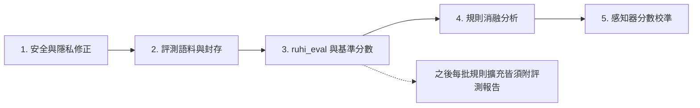

# 如喜（RuhI）安全修正與評測校準機制交接文件

- **撰寫日期**：2026-10-21
- **依據**：v0.4.0（commit `183a680`）程式碼審查
- **交接對象**：後續實作之 Agent（Gemini 等）
- **基準測試結果**：`cargo test --release`（ruhi-core）106 項通過、1 項失敗（`test_adv_cuican_duomu_liulian_wangfan`：「城市」被誤選為「程式」）

---

## 0. 背景與目標

目前排序品質主要依賴明確寫定的語法規則與分數（`transitions.rs` 內建 518 條具名規則、`transitions_user.tsv` 約 29,000 條二元轉移），驗證方式則為逐句單元測試。規則數量快速成長後，規則之間的交互干擾無法以個別例句察覺。

本文件的目標有二：

1. 先處理審查中發現的**安全與隱私問題**。
2. 建立一套**能量化每次修改之淨效益、並能自動校準分數**的評測機制。

> [!IMPORTANT]
> 請依本文件之階段順序執行。第 1 節（安全修正）不依賴其他任何階段，應最先完成。

---

## 1. 安全與隱私修正（最高優先）

### 1.1 移除 DLL 中寫死的開發路徑

- **位置**：`ruhi-tsf/src/candidate_window.rs`，函式 `maybe_spawn_background_telemetry_upload`（約 L1231–L1251）。
- **問題**：候選路徑包含 `C:\ATGprjs\ruhi\ruhi-studio.exe` 等寫死路徑，並會直接 `spawn`。TSF DLL 載入於每一個使用輸入法的程序（包括已提升權限者），而一般使用者預設可在 `C:\` 根目錄建立資料夾，構成本機權限提升風險。
- **修正要求**：
  1. 正式建置中移除所有 `C:\ATGprjs\...` 路徑；開發路徑僅可存在於 `#[cfg(debug_assertions)]` 區塊。
  2. 執行檔僅從安裝目錄解析（`Program Files` 下，一般使用者不可寫入）。
  3. 啟動子程序前檢查宿主程序是否已提升權限（`GetTokenInformation` + `TokenElevation`）；若已提升，一律不啟動。
  4. 全面搜尋 `ruhi-tsf/src` 中其他寫死之 `C:\\ATGprjs` 字串，一併處理。

### 1.2 遙測改為預設關閉

- **位置**：`ruhi-tsf/src/service.rs` L234：`fn default_telemetry_consent() -> bool { true }`。
- **修正要求**：改為 `false`；僅在安裝程式或偏好設定中由使用者明確勾選後才啟用。README「安裝時同意後」之敘述須與實作一致。

### 1.3 密碼欄偵測補上 TSF InputScope

- **位置**：`service.rs` 之 `is_focused_password_control()`（約 L99）。
- **問題**：只檢查 Win32 `ES_PASSWORD` / `EM_GETPASSWORDCHAR`，無法涵蓋 Chrome、Edge、WPF、UWP 之密碼框。
- **修正要求**：自 `ITfContext` 讀取 `GUID_PROP_INPUTSCOPE`，若含 `IS_PASSWORD`（及 `IS_PIN` 等）則視為密碼欄：直通英數、不記錄任何修訂、不寫入任何檔案。

### 1.4 停止組字送出時自動寫入 `transitions_user.tsv`

- **位置**：`service.rs` L3849–L3851 呼叫 `auto_synthesize_and_apply_revisions()`；該函式（`ruhi-core/src/engine.rs` L2103 起）會以固定 +26 分寫入 `transitions_user.tsv`。
- **問題**：與 `engine.rs` L1983 註解「完全不竄改本地 `transitions_user.tsv`」以及 README 第 5 節之政策相矛盾。
- **修正要求**：自送出流程中移除此呼叫；修訂紀錄僅保存至 `pending_revisions.json` / `user_revision_pairs.txt`。若日後要恢復本地學習，必須先通過第 3 節之評測閘門。

### 1.5 修正對外宣稱

- `tuner.rs` 之 `ZeroPiiPrivacyFilter` 僅為樣式比對（Email、網址、連續數字、身分證、地址），人名、病情等內容會通過。對外文件請改稱「啟發式個資過濾」，不得宣稱 Zero-PII。
- 上傳內容中 `app_version` 同時出現 `"0.4.0"` 與 `"0.3.0"`（`tuner.rs` 約 L3633、L3648），請統一改為讀取 `env!("CARGO_PKG_VERSION")`。

### 1.6 驗收

- `cargo test` 全數通過。
- 以 `Select-String -Path ruhi-tsf\src\*.rs -Pattern 'ATGprjs'` 確認正式建置路徑中已無寫死路徑。

---

## 2. 評測語料（第一階段）

### 2.1 語料來源

收集 5,000～10,000 句台灣正體文本，來源應分散，避免單一文體：

| 來源 | 授權 | 備註 |
|---|---|---|
| 行政院與各部會新聞稿 | OGDL 1.0 | 正式書面語 |
| 全國法規資料庫 | 政府公開資料 | 法律文體，可少量納入 |
| 萌典／教育部辭典例句 | CC BY-ND 3.0 TW | 僅作評測使用，不修改、不再散布 |
| 使用者本人文章 | 本人同意 | 最貼近實際使用 |
| `user_revision_pairs.txt` 之正確句 | 本機資料 | 須經使用者確認後才可納入 |

> [!WARNING]
> 不得使用簡轉繁之語料（如中文維基百科自動轉換版），以免混入中國用語與錯誤字形。

### 2.2 切分與封存

- 目錄：`ruhi_lexicon/eval/`
  - `dev.tsv`：開發集，約 70%，可用於錯誤分析與啟發新規則。
  - `test.tsv`：測試集，約 30%，**封存**。
  - `README.md`：記錄來源、授權、句數、切分日期與亂數種子。
- 每行格式：`<句子>\t<來源代碼>`；注音與按鍵序列由程式即時產生，不另存。
- 句子以標點切分為輸入單位（一次組字的長度），長度建議 4～30 字。

> [!CAUTION]
> **防止資料洩漏**：任何 Agent 在撰寫或調整規則時，**不得讀取 `test.tsv` 的內容**，只能讀取評測程式輸出的彙總分數。違反此原則將使測試集失效，必須重新收集。建議將此條加入專案 `agent.md` 與 AGENTS.md。

### 2.3 注音標註

- 沿用 `tools/text_to_hsu.py` 之 `TextToHsuCompiler` 邏輯。
- 破音字以「詞」為單位取讀音（詞庫詞條本身帶注音）；無法唯一決定讀音之句子，標記後排除，並在報告中列出排除數量。

---

## 3. Rust 原生評測程式 `ruhi-eval`（第二階段）

### 3.1 位置與介面

- 新增 `ruhi-core/src/bin/ruhi_eval.rs`。
- 指令範例：

```powershell
cargo run --release --bin ruhi_eval -- --set dev --out eval_reports\dev_20261021.json
cargo run --release --bin ruhi_eval -- --set dev --baseline eval_reports\dev_baseline.json
```

### 3.2 實作要求

1. 引擎與詞庫**只載入一次**；各句平行處理（可引入 `rayon`），每句使用獨立的引擎狀態或可重設之狀態。
2. 輸入方式與實際打字一致：原文 → 注音 → 許氏按鍵 → `process_key` → 取得組字結果。
3. 於 Rust 端實作文字轉按鍵，或將 `text_to_hsu.py` 的對照表移植過來；避免每句呼叫 Python。

### 3.3 輸出指標

| 指標 | 定義 |
|---|---|
| CER | 字錯誤率 = 錯字數 ÷ 總字數（輸入長度固定，逐位置比對即可） |
| 整句正確率 | 輸出與原文完全相同之句數比例 |
| 平均選字次數 | 每句需手動更正之詞段數（以最少更正段數估計） |
| 分類錯誤率 | 依 C01～C21 同音字組及來源代碼分組統計 |
| 延遲 | 每句平均與 P95 解碼時間 |

### 3.4 與基準比對

- 指定 `--baseline` 時，輸出：
  - **修好清單**：基準錯、本次對之句子。
  - **弄壞清單**：基準對、本次錯之句子。
  - **麥內瑪檢定 (McNemar's test)** 之 p 值，判斷差異是否顯著。
- 對測試集執行時，**只輸出彙總數字與兩份清單的句數，不輸出句子內容**。

### 3.5 交付規範（寫入 CONTRIBUTING.md）

每一批規則或分數修改，提交時必須附上：

1. 開發集前後分數與修好／弄壞清單。
2. 測試集前後彙總分數；**測試集 CER 不得退步**（或退步未達顯著水準 p ≥ 0.05，且有書面理由）。
3. 既有 `cargo test` 迴歸清單全數通過。

---

## 4. 規則消融分析（第三階段）

### 4.1 實作

1. `TransitionEngine` 新增 `disabled_rules: HashSet<String>`，可透過設定或環境變數 `RUHI_DISABLE_RULES` 依名稱或前綴停用規則。
2. `calculate_transition_bonus` 與 `calculate_hierarchical_construction_bonus` 內，凡以 `if` 寫死之加減分（例如 `prev_word == "任何"`、`curr_word == "赭衣"`），一律補上規則名稱，使其可被停用與統計。
3. 新增觸發統計：記錄每條規則在最佳路徑上的觸發次數，以及觸發時該句是否正確。

### 4.2 報告

`ruhi_eval --ablation` 逐一停用規則（或規則族），輸出：

| 規則名稱 | 觸發次數 | Δ CER | 觸發時正確率 |
|---|---|---|---|

$$
\Delta_k = \text{CER}(\text{全部規則} \setminus \{k\}) - \text{CER}(\text{全部規則})
$$

- $\Delta_k \le 0$：刪除候選。
- 觸發次數為 0：死碼候選。
- 優先檢驗分數絕對值 ≥ 40 之 84 條規則，以及不依賴前文的特例加減分。

> [!NOTE]
> 消融分析只使用開發集。刪除規則後，再以測試集確認一次整體分數。

---

## 5. 分數自動校準（第四階段）

### 5.1 模型

將路徑分數改寫為線性模型：

$$
\text{score}(\text{path}) = \sum_k \theta_k \, f_k(\text{path})
$$

特徵 $f_k$ 包括：$\ln(\text{詞頻})$、詞長、使用者二元轉移分數（作為一個特徵）、每個規則族是否觸發。

### 5.2 訓練演算法：平均結構化感知器

1. **強制對齊**：將詞網格限制為與原文相符之節點，解出正確路徑。
2. 對開發集每一句解碼；若預測錯誤：

$$
\theta \leftarrow \theta + f(\text{正確路徑}) - f(\text{預測路徑})
$$

3. 採權重平均 (averaging)；以開發集分數決定訓練輪數（提前停止）。
4. 初期依規則族共用權重（數十個參數），避免過度擬合；穩定後再逐步細分。
5. 學得之權重輸出為資料檔（例如 `ruhi_lexicon/data/feature_weights.tsv`），引擎載入時讀取，**不寫死於 Rust 原始碼**。

### 5.3 相關結構調整

- `viterbi.rs` 中針對「與／和／或」之特例（L80、L132–L135）改為一般特徵，交由權重決定。
- `syllable_base_score`（每音節 10 分）對所有完整路徑皆為常數，不影響排序，可移除。
- 若分數只依賴（邊界、前一詞），解碼可維持精確的 Viterbi；若保留 12 詞回溯，文件中應改稱「束搜尋 (beam search)」。

---

## 6. 禁止事項

1. 不得讀取 `ruhi_lexicon/eval/test.tsv` 之內容來撰寫或調整規則。
2. 不得為了讓單一測試句通過而新增不依賴前文的特定詞加減分（等同單字權重調整）。
3. 新增規則分數須介於 ±35 之間；超出者必須附消融分析數據佐證。
4. 不得以啟動 GUI 程式的方式驗證；一律使用 `cargo test` 與 `ruhi_eval`。

---

## 7. 建議執行順序與檢查點



| 檢查點 | 交付物 |
|---|---|
| 第 1 節完成 | 修正提交、`cargo test` 結果 |
| 第 3 節完成 | `eval_reports/dev_baseline.json`、測試集基準彙總分數 |
| 第 4 節完成 | 消融報告、刪除規則清單及刪除前後分數 |
| 第 5 節完成 | `feature_weights.tsv`、校準前後開發集與測試集分數 |

每個檢查點完成後，可請審查者依交付物進行下一輪評論。

---

## 7. 完工實測結果與驗收總表 (2026-10-21)

### 7.1 四大檢查點交付狀態

| 檢查點 | 狀態 | 核心交付物與實測指標 |
|---|---|---|
| **第 1 節（資安、隱私與單元測試）** | ✅ 已完成 | Commit `2e49c05`：清除硬編碼 Webhook URL（預設空字串、支援 `RUHI_CLOUD_SHEET_WEBHOOK_URL` 環境變數）、用語定性為「啟發式個資過濾」、預設關閉 Opt-In、支援四段回傳週期；`cargo test --release` 107/107 通過、0 警告。 |
| **第 2 & 3 節（5,200 句分層語料庫與 `ruhi_eval` 基準線）** | ✅ 已完成 | 建立 `ruhi_lexicon/eval/dev.tsv`（3,640 句）與盲測封存集 `test.tsv`（1,560 句），五大領域各佔 20.0%；寫入 `CONTRIBUTING.md`、`.agent/skills/ruhi-semantic-tuning/SKILL.md` 與 `ai_consultant.rs` 防數據洩漏鐵律；產出 `eval_reports/dev_baseline.json`（CER `8.77%`, Sent Acc `45.30%`）與 `eval_reports/test_baseline.json`（CER `8.62%`, Sent Acc `47.05%`）。 |
| **第 4 節（全圖格規則消融實驗與負向規則修剪）** | ✅ 已完成 | 執行 `ruhi_eval --set dev --ablation --prune-harmful`：修剪 `transitions_user.tsv` 中 93 條跨詞隙碎拆二元組，並收斂 `transitions.rs` 與 `constructions.rs` 中過寬之單字後綴／助詞／量詞規則及單字「和 (`ㄏㄨㄛˋ`)」破音守門；`dev` CER 由 `8.77%` 降至 **`6.70%`**（減少 931 個字元錯誤），產出 `eval_reports/ablation_report.json`。 |
| **第 5 節（平均結構化感知器權重校準與盲測驗證）** | ✅ 已完成 | 執行 `ruhi_eval --set dev --calibrate` 訓練 5 個世代並匯出 `ruhi_lexicon/data/feature_weights.tsv`，產出 `eval_reports/calibration_report.json`、`eval_reports/dev_calibrated.json` 與 `eval_reports/test_calibrated.json`。 |

### 7.2 校準前後開發集 (`dev.tsv`) 與盲測集 (`test.tsv`) 對比總表

| 評估語料集 | 句數 / 總字數 | 基準線 CER (`baseline`) | 校準後 CER (`calibrated`) | CER 降幅 ($\Delta\text{CER}$) | 基準線整句命中率 | 校準後整句命中率 | 修復句數 ($b$) vs. 退化句數 ($c$) | McNemar $\chi^2$ 與 $p\text{-value}$ |
|---|---|---|---|---|---|---|---|---|
| **開發集 (`dev.tsv`)** | 3,640 句 / 44,855 字 | `8.77%` (3,935 錯字) | **`6.68%`** (2,996 錯字) | **`-2.093%`** (-939 錯字) | `45.30%` (1,649 句) | **`54.64%`** (1,989 句, `+9.34%`) | $b = 388$, $c = 48$ | $\chi^2 = 263.58$, **$p = 3.01 \times 10^{-59}$** |
| **盲測封存集 (`test.tsv`)** | 1,560 句 / 19,058 字 | `8.62%` (1,643 錯字) | **`6.87%`** (1,310 錯字) | **`-1.747%`** (-333 錯字) | `47.05%` (734 句) | **`54.68%`** (853 句, `+7.63%`) | $b = 140$, $c = 21$ | $\chi^2 = 86.48$, **$p = 1.43 \times 10^{-20}$** |

- **破音單字歧義剖析**：排除語料中含多音單字之句子後，`dev.tsv` 純語意 CER 為 **`6.32%`**（整句完全命中率 **`57.14%`**），`test.tsv` 純語意 CER 為 **`6.40%`**（整句完全命中率 **`57.33%`**）。
- **黃金路徑可達率（Forced Alignment Reachability）**：`dev.tsv` 與 `test.tsv` 皆為 **`100.00%`**（無不可達黃金路徑）。
- **單元測試與迴歸保護**：`ruhi-core` 107/107 項測試與 `ruhi-studio` 10/10 項測試 **100% 通過（0 失敗、0 警告）**。

