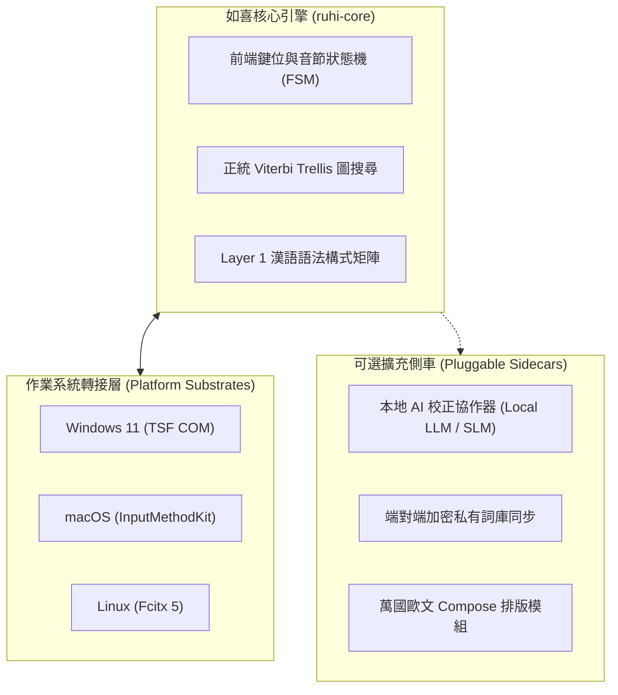
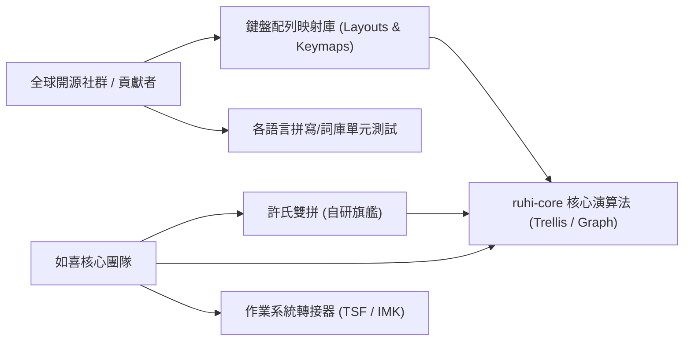

# 🌐 如喜（RuhI）通用智慧型輸入法：安裝架構與全球生態藍圖
# (RuhI Universal IME: Installer Architecture & Global Ecosystem Blueprint)

> **「通天達地，行雲流水，心手合一。」**  
> 如喜（RuhI）不僅是立足於台灣正體的頂級長句注音輸入法，更是面向下一個世代、兼顧極致手感、隱私安全、跨語跨族群的**全模組化通用輸入底座（Universal Input Substrate）**。

---

## 📑 目錄 (Table of Contents)

1. [核心架構哲學與解耦願景](#1-核心架構哲學與解耦願景)
2. [安裝模式與目標族群劃分 (Persona & Profiles)](#2-安裝模式與目標族群劃分-persona--profiles)
   - 2.1 繁體中文全能旗艦模式 (Traditional Chinese Universal)
   - 2.2 純歐文獨立排版模式 (Western Typography Only)
   - 2.3 杜絕系統工作列「幽靈雙重項目」之鐵律
3. [亞洲與全球多語言輸入延伸 (Beyond Han Characters)](#3-亞洲與全球多語言輸入延伸-beyond-han-characters)
   - 3.1 婆羅米系文字與複合音節體系
   - 3.2 日文與韓文輸入之市場定位與創新切入點
4. [全開源生態與社群協同維護規範 (Open Source Everything)](#4-全開源生態與社群協同維護規範-open-source-everything)
   - 4.1 許氏雙拼為自研旗艦，其餘配列一律全面開源
   - 4.2 標準化前端鍵位映射與狀態機抽象 (FSM Plugin System)
5. [本地 AI 校正協作引擎 (Local AI Co-Pilot Architecture)](#5-本地-ai-校正協作引擎-local-ai-co-pilot-architecture)
   - 5.1 零強迫、完全解耦架構
   - 5.2 安裝後動態隨插即用（免重裝輸入法主程式）
   - 5.3 模型生態與技術來源優先序
6. [偏好設定中心與無障礙互動體驗 (User Experience & Settings Hub)](#6-偏好設定中心與無障礙互動體驗-user-experience--settings-hub)
   - 6.1 比照自然輸入法的輸入座（候選字窗）直覺入口
   - 6.2 系統級捷徑與管理規範
7. [Windows TSF 註冊與系統維護準則 (Registry & TSF Protocols)](#7-windows-tsf-註冊與系統維護準則-registry--tsf-protocols)

---

## 1. 核心架構哲學與解耦願景

如喜（RuhI）堅守三大底層架構原則：



1. **極速優先（Zero Latency）**：核心輸入必須在 1~3 毫秒內完成網格搜尋（Viterbi Trellis）與上屏，絕不允許因外掛模組或 AI 推論阻斷鍵盤敲擊。
2. **純本地與零隱私外洩（Zero-PII Local-First）**：所有分詞、自學習詞庫與預測模型均留在本機，不依賴任何外部雲端伺服器。
3. **高內聚、低耦合（Modular Decoupling）**：輸入法核心驅動（TSF DLL）、設定介面（UI）、鍵盤配列映射庫（Keymaps）、本地 AI 協作引擎（AI Co-pilot）各司其職，相互獨立升級。

---

## 2. 安裝模式與目標族群劃分 (Persona & Profiles)

安裝程式必須具備**多語言介面（繁體中文 / 英文）**，自動依據作業系統語言設定切換，並在安裝精靈中提供清晰的安裝模式選擇：

### 2.1 繁體中文全能旗艦模式 (Traditional Chinese Universal)
- **目標對象**：台灣及全球繁體中文使用者、需要大量中英混打與西文智慧排版的工作者。
- **預設配置**：
  - 核心註冊至 Windows `繁體中文 (台灣)`（`0x0404`）。
  - 單一輸入法入口即可搞定中文與英歐文：以 `Shift` / `Caps Lock` 快速切換中英，兼具西文智慧引號（`“` `”`）、破折號、中西文自適應間距。
  - 支援 Compose 組合鍵與前綴輸入萬國歐文重音字元（如法文 `é` `ç`、德文 `ä` `ö` `ü` `ß`、西文 `ñ`、北歐字母等）。

### 2.2 純歐文獨立排版模式 (Western Typography Only)
- **目標對象**：完全不懂中文、不需要漢字分詞，但需要極致西文排版、雙引號/單引號自動對稱、多國重音字母輸入的歐美使用者。
- **配置原則**：
  - 僅掛載西文排版引擎與 Compose 鍵表，完全關閉漢字 Trie 字典與注音/拼音狀態機，降低記憶體佔用。
  - 掛載為系統標準鍵盤或專屬 Western Typography 佈局，不含任何中文字詞推薦。

### 2.3 杜絕系統工作列「幽靈雙重項目」之鐵律
- **禁忌**：**絕對嚴禁**在同一使用者的系統中同時無腦註冊 `0x0404 (zh-TW)` 與 `0x0409 (en-US)` 兩套完全相同的輸入法設定檔。
- **後果**：此舉會導致 Windows 工作列在使用者按下 `Win + Space` 或 `Alt + Shift` 時，出現兩個一模一樣的輸入法項目，嚴重破壞使用體驗。
- **規範**：安裝程式應在安裝前檢測使用者選擇之模式，**永遠只為當前使用者註冊唯一的目標設定檔**。

---

## 3. 亞洲與全球多語言輸入延伸 (Beyond Han Characters)

如喜架構的長遠目標是成為支援廣泛語言文字的通用底座：

### 3.1 婆羅米系文字與複合音節體系 (Brahmic Scripts)
- **涵蓋範疇**：天城文（Devanagari，印地語/梵語）、泰文、藏文、緬甸文、高棉文等。
- **技術共通性**：
  - 婆羅米系文字高度依賴「子音＋母音記號＋疊字/結合符（Virama/Halant）」的重組規則。
  - 如喜的音節有限狀態機（FSM）可直接抽換為複合文字組合規則引擎，將輸入鍵序即時轉換為合法的 Unicode 音節簇。

### 3.2 日文與韓文輸入之市場定位與創新切入點
- **日文（Japanese IME）**：
  - 現況：ATOK、Google 日文輸入法、微軟日文輸入法已相當成熟。
  - 如喜切入價值：日語漢字轉化、假名長句預測、中日英免切換無縫混打、極致輕量、以及整合本地 AI 語境即時校正。
- **韓文（Korean Hangul）**：
  - 現況：韓文為初聲、中聲、終聲的字母組合方塊字。
  - 如喜切入價值：智慧自動分詞與外來語預測、打字錯誤自動容錯校正。

---

## 4. 全開源生態與社群協同維護規範 (Open Source Everything)

為落實真正的通用到底與長久開源生命力，專案確立維護責任劃分：



### 4.1 核心團隊與社群配列劃分
- **如喜自研旗艦**：**許氏鍵盤雙拼注音**由核心團隊負責維護、優化語法構式矩陣與 Trellis 長詞凝聚力。
- **社群共同維護配列（全面開源開放）**：
  - 標準大千注音、倚天 26 鍵、倚天 41 鍵、漢音、微軟雙拼、小鶴雙拼、拼音。
  - 倉頡（三代/五代）、速成、大易、行列、無蝦米相容字根。
  - 歐文與各國文字配列。
- **開源資產**：所有鍵盤配列的安裝腳本、鍵位映射規則、狀態轉換表、字根字庫編譯器與單元測試，**一律完整開源於 GitHub**，歡迎有心人士與社群專家直接提交 PR 維護。

### 4.2 標準化前端鍵位映射介面 (FSM Plugin System)
- `ruhi-core` 定義清晰的 `KeyMapper` Trait：
  ```rust
  pub trait KeyMapper: Send + Sync {
      fn process_key(&mut self, key_event: KeyEvent) -> KeyAction;
      fn reset(&mut self);
      fn current_syllable(&self) -> String;
  }
  ```
- 任何鍵盤配列只要實作此介面並提供對應測試，即可立即享有如喜強大的 Viterbi 圖搜尋與詞庫引擎。

---

## 5. 本地 AI 校正協作引擎 (Local AI Co-Pilot Architecture)

本地 AI 校正為如喜「語意理解與智慧防錯」的進階拼圖，但必須嚴格遵守以下架構準則：

### 5.1 零強迫、完全解耦架構
- **輕量本體為本**：如喜純演算法引擎（`ruhi-core`）在無 AI 狀態下依然具備頂級的 Viterbi 長句推論與 Layer 1 語法構式判斷，速度極致、記憶體極小。
- **本地 AI 為輔**：AI 僅作為長句校對、語病糾錯、上下文補全的**非阻塞異步側車（Asynchronous Sidecar）**。

### 5.2 安裝後動態隨插即用（免重裝輸入法）
- **安裝精靈流程**：
  - 使用者在初次安裝如喜時，可自由勾選「立即下載安裝本地 AI 模型」或「暫不安裝，維持極速純算法模式」。
- **事後隨插即用**：
  - 若初次未安裝，使用者**絕對不需要重新安裝如喜主程式**！
  - 日後任何時候，使用者只要打開「如喜偏好設定中心」➔「本地 AI 協作」，點選「一鍵啟用」，設定介面便會自動下載對應模型權重並配置本地推論服務。
  - 亦可直接填入使用者本地已啟動的 llama.cpp、Ollama 或相容 API 端點。

### 5.3 模型生態與技術來源優先序
- **嚴格遵守技術來源規範**：
  1. **Google 生態優先**：Gemma 2B / 270M 輕量模型、Google on-device ML 工具鏈。
  2. **歐美優質開源模型順位**：Mistral、Meta Llama 輕量量化版本。
  3. **徹底排除中國來源**：嚴禁採用 Qwen、DeepSeek 等具有意識形態偏見與敏感詞審查之模型。

---

## 6. 偏好設定中心與無障礙互動體驗 (User Experience & Settings Hub)

使用者不需要也不應該去安裝資料夾裡翻找設定檔或手動執行命令。

### 6.1 輸入座即時直覺入口（比照自然輸入法）
- **齒輪圖示直達**：
  - 在如喜桌面候選字視窗（Candidate Window）與狀態列右側，常駐齒輪圖示 `⚙`。
  - 滑鼠游標移至齒輪時顯示手型游標（`IDC_HAND`），左鍵單擊立即透過非分離工作階段喚醒「如喜偏好設定中心」。
- **滑鼠右鍵選單**：
  - 在候選字視窗或狀態列任一處點擊滑鼠右鍵，即刻彈出原生上下文選單，提供「偏好設定中心 (&S)...」、「輸入法版本資訊 (&A)...」。

### 6.2 系統級捷徑與管理規範
- **捷徑自動生成**：安裝完成後自動於「桌面」與「開始功能表 ➔ 應用程式清單」建立「如喜偏好設定中心」捷徑。
- **交付與啟動規範**：
  - 設定視窗為原生 GUI 程式，啟動時一律採用 Windows 分離式指令（`cmd.exe /c start "" python app.py`），絕不以 Agent 背景守護進程（`IsDaemon: true`）執行。

---

## 7. Windows TSF 註冊與系統維護準則 (Registry & TSF Protocols)

針對 Windows 系統級別的維護與註冊，建立標準規範：

1. **唯一性原則**：
   - 繁體中文環境僅保留 `HKLM:\SOFTWARE\Microsoft\CTF\TIP\{CLSID}\LanguageProfile\0x00000404` 唯一項目，徹底清除任何歷史殘留之 `0x00000409`。
2. **極簡維護指引**：
   - 不再製造冗餘、脆弱的包裝批次檔。
   - 若使用者需要手動修復或更新 TSF 元件，唯一標準指令為：
     > **以系統管理員身分執行 PowerShell，並執行：**  
     > `.\scripts\一鍵安裝.ps1`
3. **AppContainer 現代相容性**：
   - 註冊腳本必須自動調用 `icacls`，為 `ruhi_tsf.dll` 授予 `*S-1-15-2-1`（ALL_APPLICATION_PACKAGES）與 `*S-1-15-2-2`（ALL_RESTRICTED_APP_PACKAGES）讀取與執行權限，確保在 Windows 記事本、Edge、Office 與 UWP 應用程式中運作順暢。

---
*文件編制日期：2026-10-01*  
*適用專案：RuhOS / ruhi (如喜通用智慧型輸入法)*
