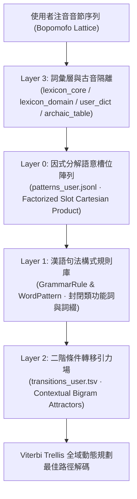

# 如喜（RuhI）漢語計算語言學架構與 AI 語意調校規範白皮書
**RuhI Computational Linguistics Architecture & AI Semantic Tuning Specification**

- **文件版本**：v2.0 (Canonical Specification for Remote & Local LLMs)
- **官方交流社群**：[**「如喜通用智慧型輸入法」LINE 社群**](https://line.me/ti/g2/iyLVoHye-Ho49K9SzQBaftTgFzej7stw9S1jSw?utm_source=invitation&utm_medium=link_copy&utm_campaign=default)
- **適用對象**：如喜語意調校工作室（`scripts/semantic_tuner.py`）、高階 AI 語意顧問（`scripts/ai_semantic_consultant.py`）、自建詞語意分析引擎（`ruhi_brain/semantic_analyst.py`）、以及任何接入之遠端或本地大型語言模型（Google Gemini、Google Gemma、OpenAI、Anthropic Claude、Llama.cpp）。
- **核心宗旨**：將智慧型輸入法的語意調校主權交還給使用者，透過嚴謹的漢語構式語法（Construction Grammar）、條件二階轉移（Conditional Bigram Transitions）與詞彙凝聚力（Lexical Cohesion）機制，使任何遠端或本地 AI 皆能依循統一標準完成高品質語意診斷與規則修正。

---

## 第一章：核心設計哲學與三大工程戒律

漢語屬於無天然詞界之連寫語言（Scriptio Continua），且注音輸入面臨高度同音異字與破音字交錯競爭。為確保輸入法在長期自適應演化中保持機率分佈平滑，所有語意調校工具與 AI 顧問必須恪守以下三大戒律：

1. **嚴禁單字權重手動調整（No Unigram Weight Whack-a-Mole）**：
   - 單字權重代表無上下文之全域先驗機率（Global Unigram Prior，$P(w)$）。
   - 為修復單一語句而調高特定單字先驗權重（例如調高「理」、「視」、「越」），必然在其他合法語境引發全域權重污染與語意劫掠（例如破壞「硬碟裡」、「奇妙的是」、「十五月」）。
   - **唯一正道**：單字層級之消歧必須 100% 透過上下文條件轉移機率 $P(w_i \mid w_{i-1})$ 或句法構式槽位解決。
2. **嚴禁無條件負向邊界抑制（No Unconditional Boundary Over-Suppression）**：
   - 在無詞界連寫長句中，任何兩個單字皆可能合法相鄰於跨詞邊界（例如「這時吧檯」、「走步董事」、「用電安全：不過載」）。
   - 嚴禁因單次組字錯誤而對單字對或合法詞施加無條件全域負分。
   - **唯一例外（語境互斥防護罩 Anti-Hijack Shield）**：僅當特定前驅詞 $w_{prev}$ 後方出現「多字同音競態詞」劫掠目標詞（如 `正常 ➔ 發灰` 劫掠 `正常 ➔ 發揮`、`自建 ➔ 詞庫` 遭 `自薦 ➔ 詞庫` 競爭）時，方可在該特定前驅詞條件下對同音多字干擾詞施加局部條件抑制（`-30.0 ~ -45.0`）。
3. **複合長詞凝聚力與實體先驗歸一化（Lexical Cohesion & Prior Neutralization）**：
   - 當錯誤源於詞庫缺乏固定複合詞、專有名詞或慣用語（如「打地鼠」被拆成「打＋的＋數」、「壓縮袋」被拆成「呀＋梭＋大」），若僅修補局部二階轉移而不補齊詞條，屬於治標不治本。
   - 必須優先將完整複合實詞收錄至領域詞庫或使用者詞庫，並依詞長賦予**安全歸一化先驗權重**（雙字詞 `750 ~ 1350`、三字詞 `820 ~ 1450`、四字以上 `880 ~ 1550`），嚴禁灌入 `2000 ~ 9999` 之破壞性極端高分。
   - **構式組合論原則**：對於可由「通用修飾語＋核心名詞」無限衍生之透明組合（如「大宇宙」、「小宇宙」、「新資料夾」），不應將整個組合硬塞為單一長詞，而應確保原子實詞存在並建立偏正構式轉移。

---

## 第二章：如喜四層語意解碼架構（Four-Tier Decoding Architecture）

如喜輸入法透過 Rust 核心引擎（`ruhi-core/src/router/transitions.rs`）與 Python 語意路由器（`tools/semantic_router.py`）實現四層協同解碼：



### 1. Layer 0：因式分解語意槽位陣列（`patterns_user.jsonl`）
- **對應模組**：`tools/semantic_router.py` 之 `FactorizedPatternEngine`。
- **核心機制**：利用笛卡兒乘積槽位（Cartesian Slot Product）$S_0 \times S_1 \times \dots \rightarrow \text{Target}$ 表達高生產力之句法模板，以 $O(N + M)$ 空間複雜度涵蓋數千種表面詞形組合，避免在 `transitions_user.tsv` 窮舉。
- **典型構式範例**：
  - 反詰疑問述語構式：`{有, 沒, 算, 哪} × {什麼, 啥, 何} × {(空), 好, 真, 那麼} ➔ [ADJ] + 的`（如「有什麼難的」、「沒什麼好怕的」）。
  - 處所動詞錨定方位構式：`{住, 住在, 位於, 處於, 走向, 飛往} × {很, 非常, 太, 最} ➔ {南, 北, 東, 西, 南邊, 北邊}`（解決「住在很南」vs「很難」之語境消歧）。

### 2. Layer 1：漢語句法構式與形態規則庫（`transitions.rs` & `semantic_router.py`）
- **核心機制**：基於封閉類功能詞集合（`function_words`）與通配模式（`Exact`, `OneOf`, `ContentWord`, `CompoundContentWord`, `Nominal`）搭配讀音錨定檢查（Phonetic Anchoring Guards）：
  1. **進行態與時相標記構式**：`{在, 正在, 都在, 總在, 還在} ➔ [動作動詞]`（區分處所/進行態「在」與重複副詞「再」）；`{已, 已經} ➔ [動詞/狀態詞]`（區分完成時相「已」與介詞「以」）；`[動詞] ➔ {了, 過, 著, 起來, 下去}`。
  2. **重複與遞進副詞構式**：`{再, 一再, 再次, 不再} ➔ [動作動詞/數量詞]`（如「再來測試」、「再打一次」）。
  3. **結構助詞「的／得／地」句法分工**：
     - 定語領屬標記「的」（台語 *ê*）：`[代詞/名詞/形容詞/方位詞] + 的 + [中心名詞]`（如「我們的小麻糬」、「很難住的男生宿舍」）。
     - 程度與結果補語標記「得」（台語 *kah*）：`[動詞/形容詞] + 得 + {很, 不得了, 要命, 一點都..., 跳起來}`（如「高興得跳起來」、「住得一點都不難住」）。
     - 狀語修飾標記「地」：`[AA/AABB 疊字形容詞 / 狀態副詞] + 地 + [動詞]`。
  4. **方位後置詞構式（Localizers）**：`[處所名詞/實體名詞] ➔ {裡, 外, 內, 中(ㄓㄨㄥ), 上, 下, 前, 後, 旁, 裡面, 底下}`（如「硬碟裡」、「看板上」、「時鐘底下」）。
  5. **關聯副詞與比較構式**：`越 + [實詞 A] + 越 + [實詞 B]`（如「越弄越大」）；`比 + [名詞] + [可分級形容詞]`。
  6. **指示代詞、數詞與量詞構式**：`{這, 那, 哪, 每, 某, 該, 上, 下} + [數詞] + [量詞] + [名詞]`（如「這一班」、「這兩句」、「每告一個段落」）。
  7. **高生產力派生詞綴構式**：`[2~4 字實詞] ➔ {庫(ㄎㄨˋ), 化, 性, 感(ㄍㄢˇ), 度, 師, 員, 器, 般(ㄅㄢ)}`（嚴格禁止前驅詞為「~的」或否定詞「沒有/不是」，防止「*普通的化」、「*沒有性去」）。
  8. **跨語系副檔名與單位構式**：`[ASCII 檔名/媒體類別] ➔ 檔`（+38.0，同時抑制政治名詞「黨」）。

### 3. Layer 2：二階條件轉移引力場（`transitions_user.tsv`）
- **資料格式**：`prev_word \t curr_word \t bonus_score \t kind \t comment`
- **分值規範**：
  - 常規搭配引力（`collocation`）：`+24.0 ~ +32.0`
  - 強固專名或跨詞防截斷引力（`strong_attractor`）：`+32.0 ~ +38.0`
  - 同音多字競態語境互斥（`anti_hijack_shield`）：`-30.0 ~ -45.0`（僅限特定 `prev_word` 下對多字同音干擾詞使用，嚴禁對單字使用）。
- **方向性原則（Directionality Principle）**：
  - 功能詞與實詞搭配時，引力必須置於「確定性錨點 ➔ 目標詞」。例如並列連詞「與愛、與死」，加權必須置於 `與 ➔ 愛/死`，絕不可置於 `前項名詞 ➔ 與`，否則所有結尾為「語」之複合詞（如「死語」、「漢語」）皆會遭截斷。

### 4. Layer 3：詞彙層、雙音節原子基準、離合詞與古音隔離層
- **雙音節原子基準與 `[2+1]` 構式不入庫原則（Disyllabic Atomic Baseline & No `[2+1]` Combinatorial Bloat）**：
  - 雙音節實詞（如「框選」、「圈選」、「點選」）為漢語構詞之原子積木，若基礎詞庫未收錄，應補入 `lexicon_domain.tsv` 以維持外層詞網跨距（防止退化為單字碎片）。
  - 但由「已登錄雙字詞＋單字中心語／類詞綴」構成之 **`[2+1]` 自由組合**（如「圈選框」、「點選框」、「勾選框」、「搜尋框」），或由「限定詞／遍指詞＋實詞」構成之**跨句法短語**（如「每點擊」、「本程式」），**嚴禁作為三字死詞寫入靜態詞庫**，必須一律交由下節之「階層式集合槽位構式語法」與二階／三階轉移處理。
- **離合詞跨距綁定（`VOCollocation`）**：支援動賓離合詞（如 `見…面`、`洗…澡`、`幫…忙`、`開…會`）在中間插入時態或數量成分（距離 $\le 3$）時給予 `+14.0 ~ +18.0` 跨距凝聚加分。
- **破音字古音與孤例隔離層（`archaic_table.rs`）**：對現代漢語零複詞之古音或孤例音（如 `感 ㄏㄢˋ`、`庫 ㄕㄜˋ`、`嗎 ㄇㄚˇ`、`害 ㄏㄜˊ`、`不 ㄈㄡ`）直接施加 `-45.0` 隔離懲罰，阻斷其冒充同音常用字。

### 5. 跨層核心機制：階層式集合槽位構式語法（Hierarchical Slot-Set Construction Grammar）
為同時避免「靜態詞庫組合爆炸」與「高階 $n$-gram 狀態空間指數爆炸」，如喜定義**雙層階層式集合槽位分解式**：
$$\text{[外層前驅槽]} \longrightarrow \text{[目標核心詞]} \longrightarrow \big[\big(\{\text{內層語素集合 }\mathcal{A}\} \longrightarrow \{\text{內層語素集合 }\mathcal{B}\}\big)\big]$$
1. **內層 $O(1)$ 位元遮罩歸約（Inner Morphological Bitmask Reduction）**：
   - 每個單字預先標註 64-bit 語素類別位元遮罩（`MorphemeMask: u64`）。當相鄰單字滿足 $(\text{mask}_1 \ \& \ \mathcal{A}) \neq 0 \land (\text{mask}_2 \ \& \ \mathcal{B}) \neq 0$ 時，在單一時脈週期（$<0.001\text{ ms}$）內動態合成為抽象構式節點：
     - **動量短語節點 $\langle\text{QP}_{\text{verbal}}\rangle$**：`[({一, 二, 三, 四, 五, 六, 七, 八, 九, 十, 百, 千, 兩, 幾, 多…} → {次, 回, 下, 遍, 趟, 番})]`
     - **書籍名量短語節點 $\langle\text{QP}_{\text{book}}\rangle$**：`[({一, 二, 三, 四, 五, 六, 七, 八, 九, 十, 幾, 每…} → {部, 本, 冊, 卷, 套})]`
     - **選取動作動詞節點 $\langle\text{V}_{\text{select}}\rangle$**：`[({圈, 點, 勾, 框, 篩, 挑, 複, 全, 單, 候} → {選, 取, 列})]`
     - **方位後置複合節點 $\langle\text{Loc}_{\text{post}}\rangle$**：`[({中, 內, 裡, 外, 上, 下, 前, 後} → {的, 面, 邊, 部, ∅})]`
2. **外層詞級三階夾擊轉移（Outer Anchor-Triggered Word Trigram）**：
   - 建立在歸約節點之上，單次跨距達 4～6 字，總運算耗時 $<0.1\text{ ms}$：
     - **遍指動量夾擊構式**：`[{每, 各}] → [點擊 (+Verb)] → [({一..十, 幾} → {次, 回, 下, 遍})]`（精準鎖定動詞「點擊」，同時不干擾 `[({一..十, 每} → {部, 本, 冊})] → [典籍 (+Noun)]`）。
     - **選取容器中心語構式**：`[({圈, 點, 勾, 框, 篩, 挑, 複, 全, 單, 候} → {選, 取})] → [{框, 欄, 區, 鈕, 鍵}]`（零三字死詞入庫，一次通殺所有 `*選框`）。
     - **框式空間介詞夾擊構式**：`[{在, 於, 從, 往}] → [框] → [({中, 內, 裡, 外, 上, 下} → {的, 面, 邊, ∅})]`。
     - **助動詞＋重複副詞三階分流構式**：`[{會, 將, 要, 能, 可, 先, 請}] → [再] → [動作謂詞]` vs. `[{會, 將, 要, 都, 整}] → [在] → [處所名詞]`。

---

## 第三章：漢語輸入法六大選字病灶診斷分類學（Diagnostic Taxonomy）

當使用者提交一組「錯誤句（Error Sentence）」與「正確句（Correct Sentence）」時，語意調校引擎與 AI 顧問必須先執行**詞界對齊（Lexicon-Aware Alignment）**與**注音音韻反查（Bopomofo Phonetic Verification）**，將問題精準歸類至以下六大病灶之一，並採取對應處方：

| 病灶代碼 | 病灶名稱 | 語言學特徵與判定條件 | 經典實例 | 標準工程處方 |
|:---|:---|:---|:---|:---|
| **Type I** | **複合長詞凝聚力缺失**<br>`OOV_COMPOUND_SHATTERED` | 正確目標詞（2~6 字）未登錄於詞庫或權重過低，導致 Viterbi 將其切碎為單字或破音字拼湊。 | `打的數` ➔ `打地鼠`<br>`模噬臍時` ➔ `模式其實`<br>`呀梭大` ➔ `壓縮袋` | 1. 將缺失之完整實詞（如「打地鼠」、「壓縮袋」）補入 `lexicon_domain.tsv`（權重 `1350~1500`）。<br>2. 建立前後文二階正向引力（`+26.0 ~ +32.0`）。 |
| **Type II** | **跨詞隙交錯搭橋截斷**<br>`OVERLAPPING_BRIDGE_HIJACK` | 正確切分為 $AB + C$ 或 $A + BC$，但詞庫中存在跨邊界雙字詞 $BC$（或 $AB$）將相鄰字元橫向吸附截斷，留下孤立單字。 | `不過載`(不過+在)<br>`盲人摸橡實`(摸象+時)<br>`很九野`(很久+也)<br>`機制諱字棟`(會+自動) | 1. 確保正確詞（如「不過」、「自動」、「很久」）在詞庫中具備完整詞條。<br>2. 建立跨越截斷點的正向引力鏈 `prev ➔ accepted` 與 `accepted ➔ next`（`+28.0 ~ +35.0`）。<br>3. 嚴禁全域封殺合法搭橋詞（如「過載」、「橡實」）。 |
| **Type III** | **同音異字詞語境競爭**<br>`HOMOPHONE_COLLOCATION` | 錯誤詞與正確詞同音同調（且多為同長度雙字詞），因先驗權重倒掛或缺乏領域上下文引力而選錯。 | `正常發灰` ➔ `正常發揮`<br>`使用者自薦` ➔ `使用者自建`<br>`破音字清茶` ➔ `破音字清查`<br>`休政行為` ➔ `修正行為` | 1. 若正確詞尚未收錄或權重偏低，補入領域詞庫。<br>2. 建立 `prev_ctx ➔ accepted` 與 `accepted ➔ next_ctx` 二階引力（`+26.0 ~ +32.0`）。 |
| **Type IV** | **封閉類功能詞構式混淆**<br>`FUNCTION_WORD_CONSTRUCTION` | 單字虛詞／功能詞同音混淆（如 `在/再`、`的/得/地`、`已/以`、`每/美`、`另/令`、`它/塌`、`和/汗`）。 | `都再打` ➔ `都在打`<br>`以安全卸除` ➔ `已安全卸除`<br>`美告一段落` ➔ `每告一段落`<br>`高興的跳起來` ➔ `高興得跳起來` | 1. 嚴禁調動單字功能詞之全域先驗權重。<br>2. 萃取「功能詞 ➔ 核心謂詞/名詞」之二階構式轉移（`+28.0 ~ +34.0`），或寫入 `patterns_user.jsonl` 因式分解槽位規則。 |
| **Type V** | **破音字或口語聲調漂移**<br>`POLYPHONIC_TONE_DRIFT` | 錯誤詞與正確詞聲母韻母相同但聲調不同（台灣口語自然變調，如「關係 ㄍㄨㄢ ㄒㄧ」、「變得 ㄅㄧㄢˋ ㄉㄜˊ」），或次常用破音字越界。 | `沒關西` ➔ `沒關係`<br>`便得更流暢` ➔ `變得更流暢`<br>`現在嗎尚` ➔ `現在馬上` | 1. 將台灣自然口語讀音與正體讀音同步收錄至領域詞庫。<br>2. 建立上下文二階引力鞏固正確詞形。 |
| **Type VI** | **使用者筆誤與混輸邊界**<br>`USER_TYPO_OR_BOUNDARY` | ① 正確句與錯誤句音韻完全不同（使用者手滑打錯字或改寫句子）；② 錯誤句為標準詞但使用者誤改為同音錯別字（如「立刻 ➔ 粒刻」）；③ 中英數混輸邊界。 | `選則` (筆誤)<br>`粒刻` (筆誤)<br>`13579年13月-1日` (數詞邊界) | 1. 啟動錯字防火牆攔截，拒絕將錯別字寫入詞庫或轉移表。<br>2. 嚴格執行 `is_valid_chinese_token` 純漢字過濾，將數字抽象化為漢語量詞/時間詞搭配（如 `年/月/日`），不寫入阿拉伯數字或標點。 |

---

## 第四章：遠端與本地 AI 語意顧問標準協定（LLM Prompt & Schema Protocol）

為徹底解決過往模型便宜行事、僅輸出粗糙規則的問題，任何呼叫遠端 AI（Google Gemini / OpenAI / Claude）或本地 AI（Google Gemma / Llama.cpp / Ollama）的請求，皆必須遵循以下**「雙階段混合智慧管線（Hybrid Neuro-Symbolic Pipeline）」**：

### 1. 階段一：本機符號引擎預先計算（Pre-LLM Symbolic Grounding）
在呼叫 LLM 之前，`SemanticTuner` 必須先以本地 24 萬詞庫與注音索引完成精確分析，並將結構化證據附入 Prompt：
- **雙向詞網對齊結果（Diff Alignment）**：`rejected`、`accepted`、`prev_ctx`、`next_ctx`。
- **注音音韻比對（Phonetic Alignment）**：附上 `rejected_bopomofo` 與 `accepted_bopomofo`，明確告知 LLM 兩者是否同音同調、同音異調或不同音。
- **詞庫存在性與權重（Lexicon Status）**：明確標示 `accepted` 與 `accepted_tokens` 是否已存在於 `lexicon_words` 中。若不存在，標示為 `[OOV 詞庫缺詞]`，強制提示 AI 評估是否收錄為新詞。
- **初步病灶分類（Pre-classified Taxonomy）**：提供符號引擎判定之病灶類別（Type I ~ Type VI）。

### 2. 階段二：AI 顧問標準輸出 JSON Schema
無論單句或批次診斷，AI 顧問必須嚴格回傳包含以下三個可執行動作層級的 JSON 結構，並由後端自動驗證、落盤與熱重載：

```json
{
  "syntactic_analysis": {
    "error_taxonomy": "Type I: OOV_COMPOUND_SHATTERED | Type II: OVERLAPPING_BRIDGE_HIJACK | Type III: HOMOPHONE_COLLOCATION | Type IV: FUNCTION_WORD_CONSTRUCTION | Type V: POLYPHONIC_TONE_DRIFT | Type VI: USER_TYPO_OR_BOUNDARY",
    "construction_name": "精確漢語語法構式名稱（如：進行態副詞構式、動賓複合詞、偏正定語構式、跨詞隙搭橋截斷）",
    "pos_breakdown": "前後文詞性與句法成分結構拆解（如：[副詞:都在] + [動賓複合詞:打地鼠]）",
    "root_cause": "結合注音音韻、詞庫權重與 Viterbi 轉移機制的具體成因說明",
    "register": "語域風格（日常口語 / 科技專業 / 正式公文 / 文言雅言）"
  },
  "unigram_safety_proof": "說明本方案如何透過長詞凝聚力與條件轉移解決問題，且不污染單字全域先驗權重",
  "recommended_lexicon_words": [
    {
      "word": "建議補入詞庫之 2~6 字完整複合詞（純漢字）",
      "bopomofo": "注音標註（可選，由後端自動補全校驗）",
      "weight": 1400,
      "category": "語意調校增補詞",
      "reason": "補齊複合詞凝聚力，防止被切碎為單字同音字"
    }
  ],
  "recommended_rules": [
    {
      "prev": "前驅詞（純漢字，1~4 字合法詞元）",
      "next": "後繼詞（純漢字，1~4 字合法詞元）",
      "score": 28.0,
      "kind": "collocation",
      "explanation": "具體句法或語意搭配理由"
    }
  ],
  "recommended_patterns": [
    {
      "name": "構式英文代號",
      "slots": [["前驅槽位候選詞1", "前驅槽位候選詞2"]],
      "target": ["目標詞"],
      "bonus": 32.0,
      "description": "因式分解語意槽位規則說明（適用於 Type IV 功能詞構式泛化，若無可為空陣列）"
    }
  ],
  "generalized_pattern": "泛化語法構式表達式（如：[進行態副詞] ➔ [動作謂詞]）"
}
```

### 3. 階段三：後端確定性驗證與多層落盤（Deterministic Verification & Persistence）
AI 回傳建議後，`SemanticTuner` 必須執行嚴格守門驗證並寫入對應層級：
1. **純漢字與合法性檢驗（`is_valid_chinese_token`）**：過濾所有包含數字、ASCII 字母、標點符號、自我轉移（`prev == next`）或筆誤之項目。
2. **Layer 3 詞庫自動收錄（`append_words_to_domain_lexicon`）**：將通過驗證的 `recommended_lexicon_words`（以及符號引擎發現之 OOV 複合實詞）自動補上注音並寫入 `lexicon_domain.tsv` 與記憶體詞庫集合 `self.lexicon_words`，使後續轉移規則能立即引用該新詞！
3. **Layer 2 二階轉移落盤（`append_rules_to_tsv`）**：將 `recommended_rules` 寫入 `transitions_user.tsv`，強制約束分值於 `+20.0 ~ +38.0` 之安全正向區間。
4. **Layer 0 因式分解構式落盤（`append_patterns_to_jsonl`）**：將泛化槽位規則寫入 `patterns_user.jsonl`，賦予引擎舉一反三之構式泛化能力。
5. **黃金語料零劣退實際解碼驗證（`verify_golden_benchmark`）**：實際以語意路由器與轉移表計算黃金測試集路徑得分，確保零負面連鎖反應。

---

## 五、全語系與跨輸入法共用高階語意消歧規範（Universal Cross-Script & Multi-Language Disambiguation）

如喜（RuhI）之計算語言學架構採「前端編碼解耦、後端語意共享」設計，使同一套 Layer 1 語法構式與 Layer 2 二階轉移矩陣同時服務音韻輸入法、字形輸入法與歐文多語系輸入：

### 1. 字形輸入法（倉頡／速成／大易／行列）重碼情境消歧（Shape-Based Collision Disambiguation）
- **單一候選確定性鐵律**：當字形碼僅對應唯一漢字時（佔倉頡／大易／行列 90% 以上字碼），100% 維持絕對確定性直出，嚴禁語意引擎干預字序。
- **重碼字（Collision Codes）與速成（Quick/Sucheng）動態語意排序**：當同一字根碼對應多個重碼字（如倉頡 `wg` 對應「理／裡／里」、`mmu` 對應「頑／元」、`to` 對應「越／月」、`it` 對應「渡／度」、`gm` 對應「瓶／坪」），或速成取首尾二碼產生數十個候選字時，`CangjieEngine` 直接查詢 `TransitionEngine::calculate_transition_bonus(prev_committed, "", candidate, "")` 與詞庫雙字詞凝聚力，使「硬碟 + `wg`」自動將「裡」排第一、「`wg` + 想」將「理」排第一、「250 + `mmu`」透過數詞量詞構式將「元」排第一。

### 2. 跨語言中英混打邊界構式（Code-Switching ASCII-CJK Boundary Construction）
- **邊界隔離防護**：當句子夾雜英文專有名詞、縮寫或副檔名（如 `aup檔`、`PDF格式`、`JSON欄位`、`API介面`）時，對齊器（`align_sentence_pair`）嚴格記錄緊鄰之 `prev_ascii`／`next_ascii`，**絕對禁止跨越 ASCII 詞元去擷取前方漢字**（防止「將 aup 檔」誤生「將 ➔ 檔」之跨界偽規則）。
- **構式泛化**：自動合成 `[<ASCII_ID>] ➔ [{檔, 檔案, 格式, 介面, 模組, 套件, 版本, 欄位}]` 跨語言混打構式，解決中英夾雜時後方單音節漢字（「檔 vs 黨」、「欄 vs 藍」）缺乏前驅漢字脈絡之問題。

### 3. 歐文多語系語法同音詞與重音符號消歧（Western Grammatical Homophones & Diacritic Restoration）
- **英語語法同音詞與縮寫構式（English Grammatical Confusables & Contractions）**：`WesternConfidenceScorer::rank_contextual_confusables` 針對高頻同音易混詞群（`their / there / they're`、`your / you're`、`its / it's`、`than / then`、`affect / effect`、`to / too`），依據前驅助動詞、介系詞、比較級形容詞與後繼詞性動態重排。
- **法語／西語／德語無重音快速鍵入自動復原（Romance & Germanic Diacritic Disambiguation）**：當使用者以標準 ASCII 鍵盤快速輸入無重音字母時，根據前後歐文語法構式自動區分功能詞與實詞重音：
  - **法語（French）**：`a`（助動詞 *avoir*，如 `il a`）vs. `à`（介系詞，如 `à Paris`、`c'est à vous`）；`ou`（連接詞「或」）vs. `où`（疑問／關係副詞「何處」）；`sur`（介系詞「在…之上」）vs. `sûr`（形容詞「確定的」，如 `bien sûr`）。
  - **西語（Spanish）**：`tu`（所有格「你的」，後接名詞如 `tu casa`）vs. `tú`（主格代名詞「你」，後接動詞如 `tú eres`）；`el`（定冠詞「這」，如 `el libro`）vs. `él`（主格代名詞「他」）；`mas` vs. `más`（程度副詞「更」）。
