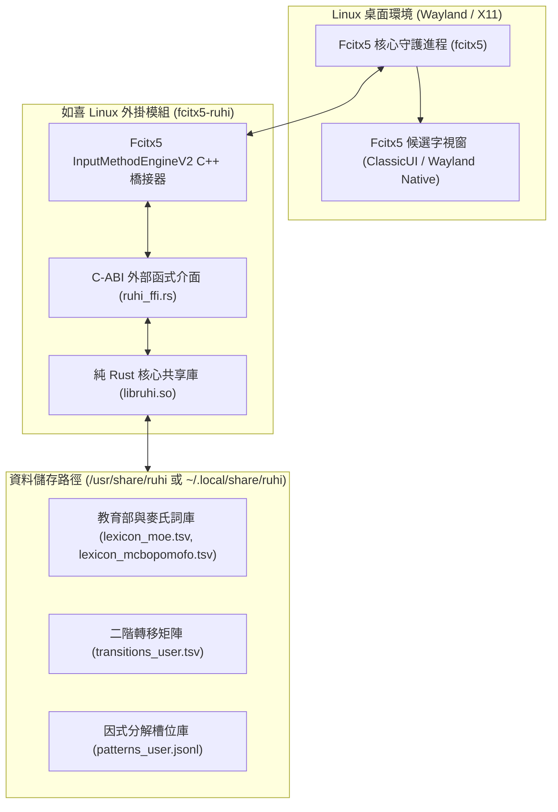

# RuhI (如喜) Linux 跨平台與 Fcitx5 架構規格書
> **文件版本**：v1.0.0  
> **建立日期**：2026-10-17  
> **面向目標**：Linux 開源社群、Arch AUR、Debian/Ubuntu 與 Fedora 打包者

---

## 🎯 一、 核心架構：純 Rust 核心的天然跨平台優勢

如喜（RuhI）的底層核心演算法庫 [`ruhi-core`](../ruhi-core) 採用 **100% 純標準 Rust** 打造，零 Windows 專屬 API（Win32 / TSF 僅存在於外層轉接層 `ruhi-tsf`）。

這意味著：
1. **天然跨平台相容**：在 Linux（x86_64, aarch64 / ARM64, RISC-V）環境下，只需執行 `cargo build --release` 即可原生編譯出高效能、零 GC 停頓的 `libruhi.so`。
2. **完整演算法能力無縫保留**：包括許氏鍵盤 FSM、正統 Viterbi Trellis 動態規劃、Layer 1 漢語語法構式矩陣、日文羅馬字引擎（`JapaneseEngine`）、歐文雙軌方向鍵預測以及 24 萬+ 詞條的教育部／麥氏標準詞庫。

---

## 🐧 二、 Linux 桌面輸入法生態對接方案（Fcitx5 Addon）

現代 Linux 發行版（Ubuntu 24.04+、Fedora 40+、Arch Linux、Debian 12+ 與 Steam Deck / SteamOS）皆以 **Fcitx5** 作為 Wayland / X11 時代的通用標準輸入法框架。

### 1. 架構對接拓撲



---

## 🛠️ 三、 C-ABI 匯出介面規格（C-FFI for Fcitx5）

在 `ruhi-core/src/ffi.rs` 中提供以下標準 C 呼叫約定（`extern "C"`）介面：

```c
// 1. 引擎生命週期管理
void* ruhi_engine_new(const char* data_dir_utf8);
void ruhi_engine_free(void* engine_ptr);

// 2. 鍵盤事件處理
// 回傳值：1 表示如喜已攔截消費該鍵；0 表示放行給宿主系統
int ruhi_engine_process_key(void* engine_ptr, int keycode, char ascii_char, int modifiers);

// 3. 畫面顯示與候選狀態獲取
const char* ruhi_engine_get_display_text(void* engine_ptr);
const char* ruhi_engine_get_composition_buffer(void* engine_ptr);
int ruhi_engine_get_candidate_count(void* engine_ptr);
const char* ruhi_engine_get_candidate_item(void* engine_ptr, int index);
int ruhi_engine_select_candidate(void* engine_ptr, int index);

// 4. 重設與清空
void ruhi_engine_reset(void* engine_ptr);
```

---

## 📦 四、 Linux 標準目錄與打包規範

### 1. 標準檔案部署位置
- **共享庫**：`/usr/lib/libruhi.so`（或 `/usr/local/lib/libruhi.so`）
- **官方系統詞庫**：`/usr/share/ruhi/data/`
- **使用者個人調校與自適應轉移表**：`~/.local/share/ruhi/data/`（XDG Base Directory 規範）
- **使用者自訂詞庫**：`~/.config/ruhi/user_dict.tsv`

### 2. Arch Linux PKGBUILD 範例規格
```bash
# PKGBUILD for fcitx5-ruhi
pkgname=fcitx5-ruhi
pkgver=0.2.0
pkgrel=1
pkgdesc="RuhI (如喜) Universal Smart IME for Fcitx5 - Pure Rust Engine"
arch=('x86_64' 'aarch64')
url="https://github.com/Yuktesha/ruhi"
license=('Apache-2.0')
depends=('fcitx5')
makedepends=('cargo' 'cmake' 'extra-cmake-modules')
source=("$pkgname-$pkgver.tar.gz::$url/archive/refs/tags/v$pkgver.tar.gz")
sha256sums=('SKIP')

build() {
    cd "ruhi-$pkgver/ruhi-core"
    cargo build --release
}

package() {
    cd "ruhi-$pkgver"
    install -Dm755 "ruhi-core/target/release/libruhi.so" "$pkgdir/usr/lib/libruhi.so"
    install -d "$pkgdir/usr/share/ruhi/data"
    cp -r ruhi_lexicon/data/* "$pkgdir/usr/share/ruhi/data/"
}
```

---

## 🐧 五、 Linux 一鍵建置與測試腳本 (`scripts/install_linux.sh`)

已為 Linux 使用者提供開箱腳本，可在任何支援 Bash 與 Cargo 的環境中直接執行：
```bash
chmod +x scripts/install_linux.sh
./scripts/install_linux.sh
```
腳本會自動完成：
1. 編譯 `ruhi-core` 為 Release 動態庫。
2. 建立 `~/.local/share/ruhi/data/` 並將完整詞庫同步至使用者目錄。
3. 執行本機冒煙測試（Smoke Test），確認 Viterbi 整句組字與日文羅馬字引擎運作正常。
