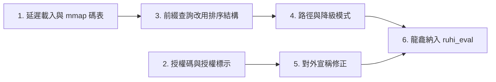

# 龍龕形音輸入法改進交接文件

- **撰寫日期**：2026-10-29
- **依據**：v0.7.0（commit `142019e`）程式碼審查與實測
- **交接對象**：後續實作之 Agent（Gemini 等）
- **前一份交接文件**：[RUHI_EVALUATION_AND_CALIBRATION_HANDOVER.md](RUHI_EVALUATION_AND_CALIBRATION_HANDOVER.md)（第 1 節安全修正已確認完成）

---

## 0. 背景與實測基準

v0.7.0 新增龍龕形音輸入法（`ruhi-core/src/longkan/`、`ruhi_lexicon/data/longkan.tsv`）與授權機制（`ruhi-core/src/entitlement.rs`）。審查時以獨立的測試程式（不修改專案）取得下列基準數據，後續修改請以相同方法重新量測並比較：

| 項目 | 實測值 |
|---|---|
| `LongkanEngine::new()` | 初始化 0.40 s，工作集約 300 MB |
| 新程序中 `RuhiEngine::new()` | 初始化 0.69 s，工作集約 515 MB |
| 每次按鍵延遲（`j`、`co`、`koko` 等） | 每鍵約 5～10 ms |
| `longkan.tsv` | 545,787 行、252,605 個不同編碼、13,000 單字、42,000 詞 |
| 每字平均編碼數 | 32.1 組（最多 125 組） |
| 單字編碼唯一率 | 60.9%（平均 2.72 個候選；`cocn` 有 200 個） |
| 二字詞編碼唯一率（依編碼計，不加權） | 64.1% |
| 前 3,000 高權重字中，至少有一組碼可排首選者 | 2,991 字 |

> [!IMPORTANT]
> 請依本文件章節順序執行。第 1、2 節影響所有使用者或涉及法律風險，應最先處理。

---

## 1. 記憶體與初始化（最高優先）

### 1.1 問題

- TSF DLL 在**每一個**使用輸入法的程序中各自建立引擎（`ruhi-tsf/src/service.rs` 約 L1145、L1285）。
- `ruhi-core/src/engine.rs` L125：`RuhiEngine::default()` 不論使用者是否啟用龍龕，一律呼叫 `LongkanEngine::new()`，完整載入碼表。
- `LongkanTable`（`longkan/table.rs`）每筆 `LongkanEntry` 含 4 個 `String`（`code`、`text`、`kind`、`breakdown`），共約 54 萬筆，另有 `char_reverse` 反查表。
- `LongkanEngine` 自行建立一份 `TransitionEngine::new()`，與 `RuhiEngine.transitions` 重複。

### 1.2 修正要求

1. **延遲載入**：`RuhiEngine` 中的龍龕改為 `Option<LongkanEngine>`（或 `OnceCell`），只在使用者的啟用模式清單包含 `longkan`，且第一次切換到龍龕或使用 `` ` `` 借用時才載入。
2. **二進位碼表與記憶體映射**：
   - 新增建置步驟，把 `longkan.tsv` 轉為排序好的二進位格式。建議使用 `fst` crate（`fst::Map` 存 編碼 → 偏移量），或自訂「排序鍵陣列 + 資料區」格式。
   - 執行時以記憶體映射（`memmap2`）唯讀開啟，讓各程序共用作業系統頁快取。
   - `text` 以 UTF-8 位元組切片存放；`kind` 改為 `u8` 列舉；`weight` 用 `u16` 或 `u32`。
3. **拆字說明改為需要時才讀**：`breakdown` 與 `char_reverse` 只在反查教練需要時才讀取，可另存一個以字元索引的區段。
4. **共用規則引擎**：`LongkanEngine` 不再自建 `TransitionEngine`，改由呼叫端傳入 `&mut TransitionEngine`（或 `&TransitionEngine`）。

### 1.3 驗收

- 未啟用龍龕時，`RuhiEngine::new()` 的工作集應回到 v0.6.0 的水準（請先量測 v0.6.0 作為對照）。
- 啟用龍龕後，龍龕本身增加的**私有**記憶體應低於 30 MB。
- 龍龕首次載入時間應低於 100 ms。
- `cargo test` 全數通過，龍龕既有測試行為不變。

---

## 2. 授權碼機制與授權標示（法律風險）

### 2.1 授權碼可被偽造

- **位置**：`ruhi-core/src/entitlement.rs` L34–L35 的 `PASSCODE_MASTER_KEY`、L306 的 `generate_passcode()`、L315 的 `derive_passcode_from_store_tx_id()`。
- **問題**：上述內容已推送到公開的 GitHub 儲存庫，任何人都能自行產生有效授權碼。即使刪除，Git 歷史中仍可取得。
- **修正要求**：
  1. 改用非對稱簽章（建議 Ed25519，例如 `ed25519-dalek`）。授權碼內容為「SKU + 交易編號 + 簽章」，**私鑰只存在伺服器或店家後台**，用戶端只內嵌公鑰並驗證。
  2. 自用戶端程式碼中移除 `generate_passcode` 與所有對稱金鑰。產生授權碼的工具移到私有儲存庫。
  3. 舊格式授權碼（`RUHI-LK70-...`）的處理方式，交由專案負責人決定；在獲得指示前請保留驗證邏輯，但不得再提供產生功能。
- **說明**：原始碼公開時，任何驗證都可能被移除。如果採行「君子協定」，README 與 `LICENSE-COMMERCIAL.md` 應明白如此宣告。

### 2.2 授權標示混亂

- 根目錄 `LICENSE` 仍是 Apache 2.0，而 `LICENSE-COMMERCIAL.md` 宣告 v0.7.0 起的龍龕相關檔案為專有軟體，這些檔案卻已公開推送。
- **修正要求**：
  1. 在每個專有檔案（`longkan/*.rs`、`reverse_coach.rs`、`entitlement.rs`、`build_longkan_tsv.py`、`longkan.tsv`）的檔頭加上授權標示。
  2. README 新增「授權範圍」一節，列出各目錄適用的授權。
  3. 是否把專有部分移到私有儲存庫，**由專案負責人決定**；Agent 不得自行刪除公開儲存庫的歷史。

### 2.3 上游資料授權

| 資料 | 位置 | 待確認事項 |
|---|---|---|
| `ids.txt`（CJKVI Database, Based on CHISE IDS） | `_archive/_external/ids.txt`，由 `build_longkan_tsv.py` L43 讀取 | 據審查者所知以 GPLv2 散布，`THIRD_PARTY_LICENSES.md` 未列出。若碼表由它衍生，以專有授權販售有風險 |
| 教育部《重編國語辭典修訂本》 | `lexicon_moe.tsv` | CC BY-ND（禁止改作）；碼表的詞彙與權重是否構成改作需釐清 |
| Unihan | `Unihan.zip` | Unicode License，需在 `THIRD_PARTY_LICENSES.md` 標示 |
| 小麥注音 | `lexicon_mcbopomofo.tsv` | MIT，需保留著作權聲明 |

- **修正要求**：
  1. 先查證 `ids.txt` 上游儲存庫的授權檔原文，把結果記錄在 `THIRD_PARTY_LICENSES.md`。
  2. 若確認為 GPL，請列出替代方案（寬鬆授權的拆字資料，或以 Unihan 等資料自建拆字表），**交由專案負責人決定**，並建議諮詢法律專業。
  3. 在 `build_longkan_tsv.py` 檔頭記錄每項輸入資料的來源、版本與授權。

---

## 3. 前綴查詢效能與排序固定性

### 3.1 問題

- `longkan/table.rs` 的 `lookup`（L444–L456）、`has_exact_or_prefix`（L513–L523）、`has_exact_or_prefix_for_mode`（L507–L509）、`has_longer_alpha_prefix`（L533 起）與 `lookup_wildcard`（L555 起），都逐一走訪 `HashMap` 的全部 25 萬個鍵。
- `process_key_with_lexicon` 每次按下字母或數字，都會呼叫上述函式一到數次。
- `HashMap` 的走訪順序每次執行都不同，權重相同的前綴候選因此排序不固定。

### 3.2 修正要求

1. 若第 1 節已採用 `fst`，前綴查詢直接使用 `fst` 的範圍或前綴串流。否則改用排序後的 `Vec<(String, …)>`，以 `partition_point` 二分搜尋找出前綴區間。
2. 權重相同時，以「編碼長度 → 文字字典序」作為固定的次排序鍵。
3. 萬用字元查詢（`?`、`*`）若仍需掃描全表，應限制在萬用字元之前的固定前綴區間內進行。

### 3.3 驗收

- 每次按鍵的查詢時間低於 0.5 ms（release 模式，以第 0 節的按鍵序列量測）。
- 新增單元測試：同一輸入連續建構兩次引擎，候選順序必須完全相同。

---

## 4. 路徑、降級模式與程式碼瑕疵

### 4.1 碼表搜尋路徑

- **位置**：`longkan/table.rs` L60–L65、L89–L93。
- **問題**：`env!("CARGO_MANIFEST_DIR")` 把編譯機的 `C:\ATGprjs\...` 路徑寫進執行檔；`PathBuf::from("data/longkan.tsv")` 等相對路徑會以宿主程序的工作目錄為基準。
- **修正要求**：正式建置只從安裝目錄與 `%APPDATA%\Ruhi\data` 讀取；開發路徑只能放在 `#[cfg(debug_assertions)]` 或測試中。碼表路徑一律由 `RuhiPaths` 傳入，不在 `Default` 中自行搜尋。

### 4.2 降級模式行為不一致

目前有三種互相矛盾的描述：

| 位置 | 描述 |
|---|---|
| `longkan/mod.rs` L32–L34（結構註解） | 暫停雙字詞 4 碼連打與前文消歧 |
| `longkan/mod.rs` L497（註解） | 單字、雙字詞與前文消歧完整開放，只封存三字以上簡碼 |
| `longkan/mod.rs` L252–L262（實際程式） | `grace_degraded` 時 `Tab` 與 `-` 直接放行，**連雙字詞都無法進入** |

- **修正要求**：先請專案負責人確認預期行為，再統一程式、註解、README 與 `LICENSE-COMMERCIAL.md` 四處的描述，並為降級模式補上單元測試（雙字詞、三字詞各一）。

### 4.3 其他

- `longkan/mod.rs` L216：`let max_code_len = if is_word_mode { 12 } else { 12 };` 兩個分支相同，請確認原意後修正。
- `longkan/mod.rs` L524–L527：呼叫 `calculate_transition_bonus` 時注音傳空字串，使破音字讀音錨定失效。請改傳碼表中該字的注音（可在建置時加入欄位），或在第 6 節評測證明有效之前，先移除這段加權。

---

## 5. 對外宣稱修正

### 5.1 數字

README L79 與 `build_longkan_tsv.py` L7 宣稱 20,992 字、172,115 詞、95,663 筆、單字編碼熵 13.70 bits、二字詞免選字唯一率 98.79%。儲存庫中沒有產生這些數字的程式，且與實際碼表不符（見第 0 節）。

- **修正要求**：
  1. 新增 `scripts/longkan_stats.py`（或 Rust 的 `ruhi_eval --longkan-stats`），從 `longkan.tsv` 計算並輸出：字數、詞數、行數、編碼數、每字編碼數分布、單字與各長度詞的編碼唯一率（不加權與詞頻加權各一）、編碼熵（並寫明定義）。
  2. README 只引用該腳本的輸出，並註明產生日期與碼表版本。

### 5.2 「全新發明」

各軌跡的核心概念已有先例：

- 字母外型對應部件：嘸蝦米（字母的形、音、義對應字根）。
- 雙拼加部首：自然碼、小鶴音形。
- 部件拼音組字：搜狗輸入法 U 模式拆字（例如 `mumumu` → 森）。

- **修正要求**：README、CHANGELOG、關於視窗與教學頁面中的「全新發明」，改為「整合創新」或類似的平實措辭，並在 README 新增「相關前案與差異」一節，說明龍龕的特點：多軌寬容碼整合於單一碼表、搭配跨輸入法反查教練、可事後融合部件。

#### 5.2.1 前案初步檢索結果（2026-10-29，網路檢索）

> [!WARNING]
> 本次僅為一般網路檢索，**未查詢專利資料庫原文**（TIPO、Google Patents、CNIPA），不能作為新穎性的依據。

| 龍龕特點 | 檢索結果 | 新穎性判斷 |
|---|---|---|
| 部件讀音組字（全拼） | 搜狗輸入法 U 模式拆字（`u mu mu mu` → 森、`u ren ji` → 仉），並可混用筆畫碼 | **已有前例** |
| 部件讀音組字（雙拼） | Rime 開源方案 `mirtlecn/rime-radical-pinyin`：以部件拼音組字，支援小鶴雙拼、自然碼等雙拼方案 | **已有前例**（但均以漢語拼音雙拼為基底） |
| 以注音為基底的雙拼（許氏）表達部件讀音 | 未找到前例 | 屬在地化延伸，概念上新意有限 |
| 形符＋聲符讀音的形聲結構配對 | 有多種音形碼與專利在取碼時考量聲旁，但未找到明確以「形符讀音＋聲符讀音」為主軸者 | **不確定**，需專利檢索 |
| 輸入座內事後部件融合（`Shift+←` + `Tab`） | 未找到主流商業輸入法提供此功能；Rime 可用 Lua 自訂類似邏輯，但未找到現成方案。手寫辨識專利中有「合併相鄰筆畫單元」，屬不同機制 | **目前最可能具新意**，需專利檢索確認 |
| 多軌寬容碼免切換並存 | 搜狗、Rime 均需先進入特定模式（如按 `u`） | 屬設計取捨，可列為差異，不宜稱首創 |

**建議措辭**（交由專案負責人定稿）：

> 龍龕以形聲結構（形符＋聲符讀音）為核心，相容注音雙拼與漢語拼音，免切換模式即可以部件讀音組字，並提供輸入座內的事後部件融合。

- 未完成專利檢索之前，任何對外文件不得使用「首創」、「全球第一」、「全新發明」等措辭。
- 若專案負責人有意申請專利，「事後部件融合」應列為優先檢索與評估的項目，且**在申請前不宜再擴大公開技術細節**（目前程式碼已公開，需請專利專業人士評估公開對新穎性的影響）。

---

## 6. 將龍龕納入評測（`ruhi_eval`）

### 6.1 指標

| 指標 | 定義 |
|---|---|
| KSPC | 打完一段文字所需的總擊鍵數 ÷ 字數（包含選字鍵與空白鍵） |
| 首選命中率 | 以每字的「主碼」輸入時，目標字排在第一候選的比例 |
| 平均候選位次 | 目標字在候選清單中的平均位置 |
| 前文加權淨效益 | 開啟與關閉 `TransitionEngine` 加權時，上述指標的差異 |

### 6.2 實作要求

1. 在 `ruhi_eval` 新增 `--mode longkan`，沿用既有的開發集與測試集。
2. 每字的「主碼」定義由專案負責人決定。在決定之前，暫以 `char_reverse` 的 `primary_code` 為準。
3. 輸出格式與既有報告一致，並支援 `--baseline` 逐句比對。
4. **測試集只輸出彙總數字**，規則與前一份交接文件相同。

### 6.3 設計建議（供專案負責人決策，Agent 不得自行變更碼表結構）

- 為每字定一組可預期的主碼給熟練使用者，寬容碼作為後備、排序在後。
- 降低最擁擠編碼（如 `cocn`、`cacn`、`cncn`）的碰撞，可依 KSPC 的改善幅度排定優先順序。
- 「完全不懂漢字的外國人也能打」的宣稱，建議先做小規模的可用性測試再保留。

---

## 7. 禁止事項

1. 不得在任何公開檔案中加入金鑰、私鑰或授權碼產生邏輯。
2. 不得自行刪除或改寫公開儲存庫的 Git 歷史。
3. 第 2.3 節的授權問題確認之前，不得新增依賴 `ids.txt` 的功能。
4. 不得讀取 `ruhi_lexicon/eval/test.tsv` 的內容。
5. 不得為了讓單一測試通過而手動調整個別編碼的權重；排序問題一律以第 6 節的評測數據為依據。
6. 不得以啟動 GUI 程式的方式驗證；一律使用 `cargo test` 與 `ruhi_eval`。

---

## 8. 執行順序與檢查點

| 檢查點 | 交付物 |
|---|---|
| 第 1 節完成 | v0.6.0 與修改後的記憶體、初始化時間對照表 |
| 第 2 節完成 | 簽章驗證實作、授權標示清單、`ids.txt` 授權查證結果與替代方案 |
| 第 3 節完成 | 每鍵延遲量測結果、排序固定性測試 |
| 第 4 節完成 | 降級模式行為確認紀錄與單元測試 |
| 第 5 節完成 | `longkan_stats` 輸出與修正後的 README |
| 第 6 節完成 | 龍龕開發集與測試集基準報告（KSPC、首選命中率） |

> [!NOTE]
> 第 2.1 節第 3 點、第 2.2 節第 3 點、第 2.3 節第 2 點、第 4.2 節、第 6.2 節第 2 點與第 6.3 節，都需要專案負責人決策。Agent 執行到這些項目時，應整理選項並暫停等候指示。

每個檢查點完成後，可請審查者依交付物進行下一輪評論。
