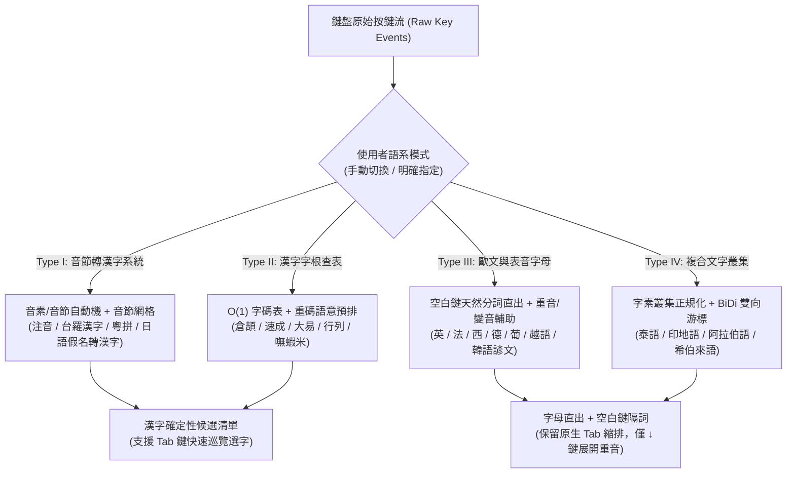

# 如喜（RuhI）多語言與跨輸入法擴充架構指引（Multi-Language & Input Method Expansion Guide）

> 🌐 **Language Editions / 文件語系版本**：[繁體中文版 (Traditional Chinese)](file:///C:/ATGprjs/ruhi/docs/RUHI_MULTILINGUAL_EXPANSION_GUIDE.md) ｜ [English Edition (國際英文版)](file:///C:/ATGprjs/ruhi/docs/RUHI_MULTILINGUAL_EXPANSION_GUIDE_EN.md)

本文件為如喜（RuhI）輸入法框架之多語言與多輸入法擴充標準規範。旨在確立**「尊重使用者手動操控主權（手動切換語系、漢字系統 `Tab` 鍵確定性選字、歐文系統空白鍵自然分詞直出）」**與**「模組化語意輔助」**並重的雙軌架構，並提供全球開發者新增任何語系或輸入法時的五步標準工程指南。

---

## 一、核心設計哲學：手動操控主權與語系本質分流

不同文字系統有截然不同的輸入物理特性，輸入法必須順應文字本質，而非強加單一交互邏輯：

### 1. 鐵律一：手動切換與自動混打分離可控（Explicit Mode Lock vs. Auto-Routing）
- 每一門語言引擎（如 [`RuhiEngine`](file:///C:/ATGprjs/ruhi/ruhi-core/src/engine.rs)、[`CangjieEngine`](file:///C:/ATGprjs/ruhi/ruhi-core/src/cangjie/mod.rs)、[`JapaneseEngine`](file:///C:/ATGprjs/ruhi/ruhi-core/src/japanese/mod.rs)、[`WesternEngine`](file:///C:/ATGprjs/ruhi/ruhi-core/src/western/mod.rs)）皆為**狀態完全隔離之獨立狀態機**。
- 當使用者偏好「自行切換語系」時，引擎嚴格鎖定於當前選定之單一語系，絕不因輸入特定字母組合而擅自跳轉至其他語系。

### 2. 鐵律二：「漢字系統 `Tab` 選字」與「歐文系統空白鍵直出」嚴格分流
- **漢字文化圈系統（中文注音／字形重碼、台語漢字、粵語漢字、日語假名轉漢字 Kanji）—— 採用確定性 `Tab` 鍵巡覽**：
  - 由於漢語與日語漢字屬於無詞界連寫（Scriptio Continua）且具高度同音／重碼字，[`TransitionEngine`](file:///C:/ATGprjs/ruhi/ruhi-core/src/router/transitions.rs) 負責溫和地將符合上下文構式的候選字預排在前 1~2 順位；
  - 當使用者按下 `Tab` 鍵或方向鍵時，清單進入**確定性鎖定狀態（Deterministic Selection Lock）**，依固定順序循環切換候選字，絕不亂跳字或覆寫使用者手動選定的字詞。
- **歐文與表音字母系統（英、法、西、德、葡、義、越、純韓文諺文）—— 採用空白鍵天然隔詞直出，100% 保留 `Tab` 原生縮排與跳格功能**：
  - 歐文系統本身即以**空白鍵（Space）**作為天然詞界，打字時字母直接輸出、按空白鍵即完成一詞並隔開，**完全不需要漢字式的 `Tab` 選字清單**；
  - 在歐文模式下，**`Tab` 鍵必須 100% 歸還作業系統與應用程式**（用於文書縮排、表格跳欄、IDE 程式碼補全），輸入法絕不攔截 `Tab` 鍵；
  - 唯有在使用者以標準 ASCII 鍵盤輸入無重音字母而想替換為法／西／德重音符號（如 `cafe ➔ café`、`a ➔ à`）時，才透過輕量提示或按 `↓` 鍵／死鍵（Dead Key）選取重音形式。

### 3. 鐵律三：語料與轉移表純淨隔離（Strict Corpus & Transition Isolation）
- 漢語二階轉移表（`transitions_user.tsv`）僅收錄純 CJK 漢字詞元；
- 其他語系之詞頻、變音規則與語法同音消歧，一律封裝於各語系專屬模組與專屬 TSV 詞庫中，確保開啟或擴充新語言時，對既有注音與字形輸入**零效能損耗、零詞庫污染**。

### 4. 鐵律四：跨輸入模式之共用輸入座基本操作一致性（Universal Composition Desk Consistency）
- 如喜輸入座（`pending_compose` 與各子引擎未決緩衝區）可於同一次組字期間同時容納多種語言字串（如中文、日文、韓文、泛歐文字混排）。因此，**不論當前處於哪一種輸入模式，輸入座的基本操作必須 100% 保持一致**（完整對照表詳見 [RUHI_ASIAN_LANGUAGES_EXTENSION_GUIDE.md 第五節](file:///C:/ATGprjs/ruhi/docs/RUHI_ASIAN_LANGUAGES_EXTENSION_GUIDE.md#L190-L225)）：
  1. **三級退格刪除（`Backspace` / `Shift + Backspace` / `Ctrl + Backspace`）**：
     - `Backspace`：部件／單一拉丁字母級回退（子引擎有緩衝區時退 1 個部件／字母；於輸入座已合成文字則退 1 個字元）。
     - `Shift + Backspace`：音節／單字塊級回退（注音退 1 個音節、倉頡／行列清空當前未決字根、韓文／日文退 1 個完整音節或未決相容字母，嚴禁退化為只刪 1 個拉丁字母）。
     - `Ctrl + Backspace`：詞彙／區段級回退（子引擎有未決緩衝區時清空當前未決詞或退 1 個 Viterbi 詞；於輸入座已合成文字時依 `pending_segments` 或語系詞段一次刪除 1 個完整詞段，嚴禁在非 ASCII 字元時退化為只刪 1 個字）。
  2. **四級階梯式 `Esc` 撤銷**：依序為 Level 1 取消反白選取 ➔ Level 2 關閉候選清單 ➔ Level 3 僅清除子引擎未決預覽並保留輸入座已合成前文 ➔ Level 4 徹底清空全部緩衝區並**同步呼叫 `hide_candidate_window()` 與 `end_tsf_composition(ctx)`**（嚴禁遺漏隱藏懸浮輸入座視窗）。
  3. **游標導覽、範圍選取與編輯快捷鍵**：`←`/`→`/`Home`/`End`、`Ctrl + ←/→` 跨詞跳躍、`Shift + 方向鍵` 範圍選取、`Delete`、`Ctrl + A/C/X/V/Z/Y` 與 `Enter` 全句上屏，在所有輸入模式下行為一致。

---

## 二、多語言擴充之四大計算語言學類型（Four Typological Tracks）

規劃新增語言或輸入法時，請先依其語言學特性歸入以下四大軌跡之一，並複用對應之底層基礎設施：



| 類型軌跡 | 代表語言／輸入法 | 前端編碼器 (Frontend FSM) | 上字與選字互動規範 (Commit & Key Behavior) | 現有參考實作範本 |
| :--- | :--- | :--- | :--- | :--- |
| **Type I：音節轉表意漢字系統**<br>*(Phonetic-to-Logographic)* | • 注音（標準／許氏）<br>• 日語（Romaji → 假名轉漢字）<br>• 台語（台羅／白話字轉漢字）<br>• 客語／粵語（粵拼轉漢字） | 音素組合有限狀態機（如許氏 26 鍵 FSM、日語 Romaji 子音母音自動機） | • 連文節／多音節網格（Lattice）Viterbi 解碼<br>• **支援 `Tab` 鍵確定性循環切換同音單字與複合詞** | • [`fsm/`](file:///C:/ATGprjs/ruhi/ruhi-core/src/fsm/)<br>• [`japanese/mod.rs`](file:///C:/ATGprjs/ruhi/ruhi-core/src/japanese/mod.rs) |
| **Type II：漢字字根查表系統**<br>*(Shape/Radical Table-Based)* | • 倉頡（Cangjie）／速成（Quick）<br>• 大易（Dayi）<br>• 行列 30（Array30）<br>• 嘸蝦米（Boshiamy） | 字根鍵碼緩衝區（1~5 碼）與萬用字元／首尾碼查詢 | • **單一候選字**：按空白鍵 100% 確定性直出<br>• **重碼字**：[`TransitionEngine`](file:///C:/ATGprjs/ruhi/ruhi-core/src/router/transitions.rs) 預排，**支援 `Tab`／數字鍵選字** | • [`cangjie/mod.rs`](file:///C:/ATGprjs/ruhi/ruhi-core/src/cangjie/mod.rs)<br>• [`cangjie/table.rs`](file:///C:/ATGprjs/ruhi/ruhi-core/src/cangjie/table.rs) |
| **Type III：歐文與表音字母系統**<br>*(Space-Delimited Alphabetic)* | • 英語、德語、法語、西語、葡語、義語<br>• 越南語（Telex / VNI 內聯變音）<br>• 韓語（Hangul 諺文直組） | 大小寫型態分類器（[`CasingPattern`](file:///C:/ATGprjs/ruhi/ruhi-core/src/western/fsm.rs)）、雙鍵內聯變音（越語 `aa`→`â`）或韓語初聲／中聲／終聲合成 | • **空白鍵天然隔詞直出，100% 不攔截 `Tab` 鍵**<br>• 法／西／德無重音鍵入時可按 `↓` 替換重音（如 `cafe`→`café`）；韓語僅在轉漢字（Hanja）時展開候選 | • [`western/mod.rs`](file:///C:/ATGprjs/ruhi/ruhi-core/src/western/mod.rs)<br>• [`western/scoring.rs`](file:///C:/ATGprjs/ruhi/ruhi-core/src/western/scoring.rs) |
| **Type IV：複合字形與雙向文字**<br>*(Complex Clusters & BiDi)* | • 泰語（Thai 母音上下疊加）<br>• 印地語（Devanagari 連字 Virama）<br>• 阿拉伯語／希伯來語（RTL 從右至左） | 字素叢集序列驗證器（防止無效聲調／母音重複疊加） | • **字母／音節即時合成直出，不攔截 `Tab` 鍵**<br>• Unicode NFC 正規化輸出與 RTL 雙向游標對齊 | 規劃擴充層（可掛載於 `ruhi-core/src/`） |

---

## 三、重點語系擴充實作藍圖（Language-Specific Blueprints）

### 1. 台語（台羅 Tâi-lô）、客語與粵語（粵拼 Jyutping）擴充藍圖
- **高度複用現有架構（複用率 > 90%）**：
  - 台語、客語、粵語在結構上與國語注音完全同構（皆為「音節含聲調 ➔ 漢字／羅馬字詞條」）。
  - **前端自動機**：建立 `ruhi-core/src/taigi/fsm.rs` 或 `cantonese/fsm.rs`，將拉丁字母音節與數字調號（如台羅 `gua2`、`tsia8` 或粵拼 `gwong2`、`jat1`）正規化為標準音節代碼。
  - **詞庫格式**：直接採用與 `lexicon_moe.tsv` 相同之三欄式 TSV（`詞彙 \t 音標序列 \t 權重`），並支援「漢字模式」、「全羅馬字模式（如 `Góa`）」與「漢羅混用模式」透過 `Tab` 鍵一鍵切換。

### 2. 大易（Dayi）與行列 30（Array30）字形輸入法擴充藍圖
- **零重複造輪，直接共用查表引擎**：
  - [`CangjieTable`](file:///C:/ATGprjs/ruhi/ruhi-core/src/cangjie/table.rs) 本質上即為通用之「字根碼 ➔ 候選漢字列表」映射器。
  - **大易 4 碼／3 碼**：僅需掛載 `data/dayi.tsv`（將 40 個字根鍵位映射至對應漢字），並開啟「單一候選直出、重碼字支援 `Tab` 巡覽與 [`TransitionEngine`](file:///C:/ATGprjs/ruhi/ruhi-core/src/router/transitions.rs) 二階排序」。
  - **行列 30**：在前端加入「一級簡碼（1 碼 + 空白鍵）」、「二級簡碼（2 碼 + 空白鍵）」與「數字鍵選字／符號區」狀態切換，後端重碼排序直接共用同一套 `TransitionEngine`。

### 3. 日語（Romaji ➔ 假名漢字連文節）雙階段演進藍圖：外國學習者最佳夥伴與新世代直覺體驗
- **產品定位理念**：現階段沒有打算沿用傳統日文輸入法「盲打整串平假名、按 `Shift + ←/→` 手動伸縮文節、記憶 `F6`~`F10`」的操作設計，而是採用如喜「即時漢字預覽 ＋ `↓` 展開漢字與平片假名 ＋ `↑` 預測與音韻容錯救援」之直覺雙軌介面。
- **階段一（全球日語學習者最佳夥伴 — 已實作於 [`JapaneseEngine`](file:///C:/ATGprjs/ruhi/ruhi-core/src/japanese/mod.rs)）**：
  1. **用言活用語幹與送り仮名自動機**：區分一段動詞、五段動詞（含促音便、イ音便、撥音便）、サ變名詞＋`する`、カ變`来る`與い形容詞之語幹（Stem）與活用語尾（`ます / ました / ません / て / た / ない / たい / かった / くない`），使學習者輸入任何時態皆可即時合成漢字（如 `tabemasu` ➔ `食べます`、`oishikatta` ➔ `美味しかった`）。
  2. **格助詞受詞搭配與同音異義消歧**：根據受詞與格助詞自動擇優同訓異字（如 `映画を観る`、`病気を診る`、`音楽を聴く`、`写真を撮る`），並於 `kagaku`（`科学`／`化学`）、`hashi`（`橋`／`箸`）提供清晰同音候選。
  3. **學習者音韻盲點 `↑` 模糊救援**：針對長音漏打（`tokyo`/`tookyoo` ➔ `東京`、`gakko` ➔ `学校`、`sensee` ➔ `先生`）、促音漏打（`gakou` ➔ `学校`、`choto` ➔ `ちょっと`）與近音誤植（`yourishi` ➔ `よろしくお願いします`），按 `↑` 鍵即時容錯救回。
- **階段二（期望透過海外口碑延伸至日語母語使用者）**：
  1. **游標滑動視窗多跨距候選展開**：支援在長句中移動 `←`/`→` 游標並按 `↓` 直接展開該位置之複合詞、單字與假名候選，免除 `Shift + ←/→` 手動拉扯文節邊界。
  2. **大規模外部 TSV 詞庫掛載**：支援載入 `data/lexicon_japanese.tsv` 與專有名詞擴充包，期望透過海外學習者的良好體驗與口碑，自然吸引更多日文母語使用者認識並嘗試這套新世代的直覺輸入方式。

### 4. 韓語（Hangul 2-Bulsik 二벌式）與越南語（Telex / VNI）擴充藍圖
- **韓語（Hangul）**：
  - 核心為確定性代數合成公式：$\text{Hangul Syllable} = \text{0xAC00} + (\text{Choseong} \times 588) + (\text{Jungseong} \times 28) + \text{Jongseong}$。
  - 當使用者繼續輸入母音時，自動執行**終聲連音拆解（Jongseong Splitting）**：例如先打 `한 (han)` 再打 `ㅏ (a)`，自動拆解為 `하 (ha)` + `나 (na)`。
  - 按 `Tab` 鍵或漢字轉換鍵時，可查詢韓漢詞典將諺文詞轉換為對應正體漢字（如 `대한민국 ➔ 大韓民國`）。
- **越南語（Telex / VNI）**：
  - 屬於 **Type III 變音組合系統**。使用者在同一個音節內任意位置補打修飾鍵（`s=銳音, f=重音, r=問音, x=跌音, j=重下點, w=短音/角音`），自動機即時將重音合成至該音節之核心母音上（如 `vieetj ➔ việt`、`nguowif ➔ người`）；若連按兩次修飾鍵則還原為英文字母直出。

---

## 四、開發者新增語言模組之五步標準作業程序（5-Step SOP）

若要在如喜（RuhI）中新增一門語言（以新增 `<lang>` 為例），請依循以下五個步驟，全程不影響既有注音與其他語言模組：

### 步驟 1：建立獨立語言子模組（`ruhi-core/src/<lang>/mod.rs`）
實作統一的狀態機介面，確保與主引擎解耦：
```rust
pub struct NewLangEngine {
    pub raw_buffer: String,
    pub candidates: Vec<String>,
    pub candidate_idx: usize,
}

impl NewLangEngine {
    pub fn new() -> Self { /* ... */ }
    pub fn reset(&mut self) { /* 清空緩衝區 */ }
    pub fn has_buffer(&self) -> bool { !self.raw_buffer.is_empty() }
    pub fn process_key(&mut self, key: &str, prev_committed: Option<&str>) -> EngineResponse {
        // 1. 漢字系統 (Type I & II)：處理 Tab / ArrowDown 確定性循環選字 (candidate_idx = (candidate_idx + 1) % len)
        //    歐文表音系統 (Type III & IV)：遇到 Tab 鍵必須回傳 EngineResponse::pass_through() 歸還系統縮排！
        // 2. 處理 Space / Enter 提交當前詞元（歐文直接連同空白鍵隔詞輸出）
        // 3. 處理 Backspace / Escape 退格與清除
        // 4. 更新 raw_buffer 並產生 candidates
    }
}
```

### 步驟 2：準備標準 TSV 詞庫（`data/<lang>_lexicon.tsv`）
- 統一採用 UTF-8 編碼、Tab 分隔之純文字格式（`編碼/讀音 \t 候選詞 \t 權重`），便於版控審閱與使用者自訂擴充。
- 在 `NewLangEngine::load_builtin_lexicon()` 中內嵌高頻核心詞條作為保底（Fallback），確保即便外部 TSV 尚未載入，引擎仍可獨立通過所有單元測試。

### 步驟 3：依文字類型接入選字與語意輔助
- **若為漢字輸出系統（台語漢字、客語、粵語、大易、行列、日語漢字）**：在 `update_candidates` 中若遇同碼多詞，可直接呼叫共用的 [`TransitionEngine::calculate_transition_bonus`](file:///C:/ATGprjs/ruhi/ruhi-core/src/router/transitions.rs#L170-L185) 取得上下文加分，並在 `process_key("Tab")` 時嚴格維持循環索引遞增。
- **若為歐文與表音系統（英、法、西、德、越、純韓文諺文）**：維持空白鍵天然隔詞直出、100% 放行 `Tab` 鍵（`pass_through`），僅在按下 `↓` 鍵或死鍵時提供重音變音與同音建議（參見 [`WesternConfidenceScorer::rank_contextual_confusables`](file:///C:/ATGprjs/ruhi/ruhi-core/src/western/scoring.rs#L105-L218)）。

### 步驟 4：於 [`RuhiEngine`](file:///C:/ATGprjs/ruhi/ruhi-core/src/engine.rs) 與 [`lib.rs`](file:///C:/ATGprjs/ruhi/ruhi-core/src/lib.rs) 註冊模式與 C-ABI 介面
1. 在 `ruhi-core/src/lib.rs` 宣告 `pub mod <lang>;` 並導出 `ruhi_engine_load_<lang>_tsv`。
2. 在 [`RuhiEngine`](file:///C:/ATGprjs/ruhi/ruhi-core/src/engine.rs) 新增對應之模式列舉或切換旗標，使偏好手動切換語系的使用者可透過單一快速鍵明確切換。

### 步驟 5：補齊單元測試與語意調校工作室規格
1. 在 `ruhi-core/src/<lang>/mod.rs` 撰寫 `#[cfg(test)] mod tests`，驗證：
   - 標準打字與空白鍵上字；
   - **`Tab` 鍵循環選字**與數字鍵選字之確定性；
   - `Backspace` 退格與 `Escape` 取消之緩衝區完整性。
2. 若需支援「如喜語意調校工作室」（[`scripts/semantic_tuner.py`](file:///C:/ATGprjs/ruhi/scripts/semantic_tuner.py)）之句對診斷，於 `synthesize_hierarchical_constructions_for_diff` 註冊該語系的構式識別規則，並確保不將外文字元寫入漢語 `transitions_user.tsv`。


---

## 五、全球多語系穿透安裝與介面母語自適應架構（Cross-Locale TSF Profile Registration & Native UI Auto-Adaptation）

### 1. 核心願景：讓全世界的使用者都能從自己的母語環境自然安裝並使用 RuhI
如喜（RuhI）定位為「通用智慧型輸入法（Universal Smart Input Method）」。全球不同母語的使用者（例如英語／歐語使用者、日語使用者、韓語使用者、繁體中文使用者）在 Windows 作業系統中，不一定會安裝「繁體中文（台灣 `0x0404`）」語言套件。因此，RuhI 在安裝與註冊時必須具備**「穿透各支援語言掛載」**與**「依選取語言自動切換介面語系與預設輸入模式」**的能力：

- 當使用者從 **Windows 語言／英文（English `en-US`）** 選取並啟用 RuhI 時：
  - 啟動後所有介面（輸入座狀態列、右鍵選單、提示膠囊、偏好設定中心 `ruhi-studio`）自動以 **英文（English）** 為主，且初始預設輸入模式自動設為歐文（或使用者上次於該語系記憶之模式）。
- 當使用者從 **繁體中文（`zh-TW`）**、**日文（`ja-JP`）**、**韓文（`ko-KR`）** 或 **法／德／西文（`fr-FR` / `de-DE` / `es-ES`）** 選取 RuhI 時，依此類推，自動對應其母語介面與初始輸入模式。

### 2. Windows TSF 多語系設定檔（Multi-LANGID Profiles）技術架構
在 [`ruhi-tsf/src/registry.rs`](file:///C:/ATGprjs/ruhi/ruhi-tsf/src/registry.rs) 與 [`ruhi-tsf/src/guid.rs`](file:///C:/ATGprjs/ruhi/ruhi-tsf/src/guid.rs) 中，單一 TSF 文字服務（`CLSID_RUHI_TEXT_SERVICE`）可透過 `ITfInputProcessorProfileMgr::RegisterProfile` 向 Windows 註冊多組語言設定檔（Language Profiles）：

| Windows 語言清單入口 (`LANGID`) | 註冊之設定檔顯示名稱 (Profile Description) | 啟動時預設 UI 語系 (`ui_lang`) | 啟動時預設輸入模式 (`default_mode`) |
| :--- | :--- | :--- | :--- |
| **`0x0404` (`zh-TW` 繁體中文)** | `RuhI如喜通用智慧型輸入法` | `zh-TW`（繁體中文） | `hsu` / `standard`（注音／字形） |
| **`0x0409` (`en-US` English)** | `RuhI Universal Smart IME` | `en-US`（English） | `latin`（Pan-European 泛歐文） |
| **`0x0411` (`ja-JP` 日本語)** | `RuhI 汎用スマート入力 (如喜)` | `ja-JP`（日本語 / English） | `japanese`（日文羅馬拼音） |
| **`0x0412` (`ko-KR` 한국어)** | `RuhI 범용 스마트 입력기 (如喜)` | `ko-KR`（한국어 / English） | `korean`（韓文羅馬拼音） |
| **`0x040C / 0x0407 / 0x0C0A` (法/德/西)** | `RuhI Universal Smart IME` | 對應歐語或 `en-US` | `latin`（Pan-European 泛歐文） |

### 3. 執行期動態偵測與設定同步流程（Runtime Locale Detection & UI Synchronization）
1. **安裝階段（Installer / `register_server`）**：
   - 偵測使用者系統目前已安裝的 Windows 鍵盤語言清單（或於安裝精靈供使用者勾選要掛載至哪些語言底下），為對應的 `LANGID` 註冊 RuhI Profile。
   - 若系統尚未建立 `config.json`，則依據當前系統 UI 語言（`GetUserDefaultUILanguage()`）或掛載之首選 `LANGID`，初始化預設 `ui_language` 與 `keyboard_layout`。
2. **切換階段（`ITfInputProcessorProfileMgr::GetActiveProfile`）**：
   - 當使用者從 Windows 右下角語言列（`Win + Space`）由「英文 - RuhI」切換至「中文 - RuhI」或「日文 - RuhI」時，[`RuhiTextService`](file:///C:/ATGprjs/ruhi/ruhi-tsf/src/service.rs) 於 `ActivateEx` 或 Profile 變更通知中讀取當前 `TF_INPUTPROCESSORPROFILE.langid`：
     - 若使用者將介面語系設為 `"auto"`（跟隨輸入語言／系統語言），則候選窗選單、狀態膠囊與設定中心自動切換為該 `langid` 對應之介面語言。
3. **跨模式簡易英文語意橋接（Universal English Semantic Bridge）**：
   - 在「不混打、嚴格依當前輸入模式分派」的前提下，同一組簡易英文語意鍵（如 `tks` / `thanks`、`hi` / `hello`、`sry` / `sorry`、`pls` / `please`）依當前所在輸入模式自動對應目標語言：
     - **中文模式** ➔ `謝謝`、`感謝`
     - **日文模式** ➔ `ありがとうございます`、`ありがとう`
     - **韓文模式** ➔ `감사합니다`、`고마워요`
     - **歐文模式（按 `↓` / `↑`）** ➔ 列出泛歐支援語言（`Thanks`, `Thank you`, `Merci`, `Danke`, `Gracias`, `Grazie`, `Obrigado`, `Dhanyavád`）。
