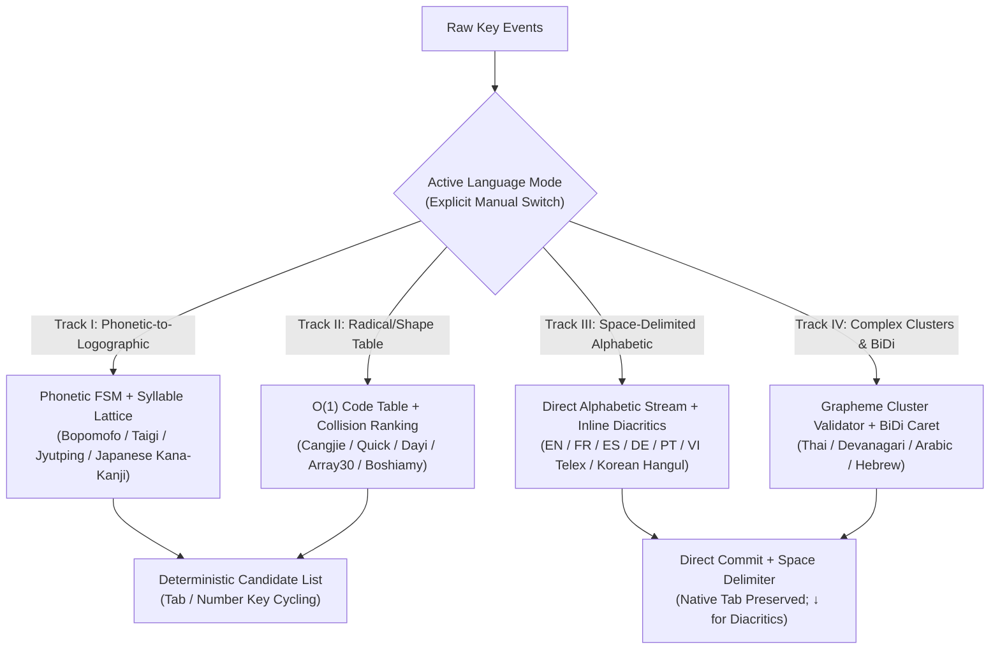

# RuhI Multi-Language & Input Method Expansion Guide

> 🌐 **Language Editions**: [English Edition](file:///C:/ATGprjs/ruhi/docs/RUHI_MULTILINGUAL_EXPANSION_GUIDE_EN.md) ｜ [繁體中文版 (Traditional Chinese)](file:///C:/ATGprjs/ruhi/docs/RUHI_MULTILINGUAL_EXPANSION_GUIDE.md)

This document defines the architectural standards and 5-step Standard Operating Procedure (SOP) for extending **RuhI (如喜)** to new languages, scripts, and input methods. It is designed for international contributors and systems engineers building input engines in Rust (`ruhi-core`).

---

## 1. Core Design Philosophy: User Sovereignty & Script-Specific Ergonomics

Different writing systems have fundamentally different physical typing mechanics. An input method framework must respect the natural ergonomics of each script rather than forcing a single interaction model onto all languages:

### Principle 1: Explicit Mode Lock vs. Optional Code-Switching
- Every language module ([`RuhiEngine`](file:///C:/ATGprjs/ruhi/ruhi-core/src/engine.rs), [`CangjieEngine`](file:///C:/ATGprjs/ruhi/ruhi-core/src/cangjie/mod.rs), [`JapaneseEngine`](file:///C:/ATGprjs/ruhi/ruhi-core/src/japanese/mod.rs), [`WesternEngine`](file:///C:/ATGprjs/ruhi/ruhi-core/src/western/mod.rs)) operates as an **isolated, deterministic finite-state machine (FSM)**.
- For users who prefer **manual mode switching** (via explicit hotkeys), the active language engine locks strictly to that language and never guesses or unexpectedly switches scripts mid-sentence.

### Principle 2: Strict Separation of CJK `Tab` Candidate Cycling vs. Western Space-Delimited Direct Typing
- **Logographic / CJK & Kanji Systems (Bopomofo, Shape/Radical Tables, Taigi/Cantonese Hanzi, Japanese Kana-to-Kanji) — Deterministic `Tab` Candidate Cycling**:
  - Because Chinese and Japanese write without spaces (*Scriptio Continua*) and exhibit high homophone or radical-collision density, [`TransitionEngine`](file:///C:/ATGprjs/ruhi/ruhi-core/src/router/transitions.rs) gently ranks contextually appropriate candidates into the top 1–2 slots.
  - When the user presses `Tab` or arrow keys to cycle through candidates, the candidate list enters a **Deterministic Selection Lock**: candidate order never reshuffles mid-selection, and manually chosen words are never overwritten.
- **Space-Delimited Alphabetic Systems (English, French, Spanish, German, Portuguese, Italian, Vietnamese, Korean Hangul) — Direct Commit on Space & 100% Native `Tab` Passthrough**:
  - Alphabetic scripts naturally segment words with the **Space** bar. Characters commit directly as typed, and pressing **Space** commits the word plus a space immediately.
  - **The `Tab` key is NEVER intercepted in alphabetic modes**—it is passed 100% untouched to the operating system and host application for indentation, form navigation, and IDE code completion.
  - Optional diacritic expansion (e.g., typing ASCII `cafe` → `café`, `a` → `à`) is triggered non-intrusively via the Down Arrow (`↓`) or inline dead-key composition.

### Principle 3: Strict Corpus & Transition Isolation
- Chinese bigram transition tables (`transitions_user.tsv`) contain strictly pure CJK tokens.
- Lexicons, morphological rules, and diacritic/homophone disambiguation for other languages live in their own dedicated Rust submodules and `.tsv` files, guaranteeing **zero memory overhead and zero corpus pollution** across languages.

---

## 2. Four Typological Tracks for Language Expansion

When adding a new language or input method to `ruhi-core`, classify it into one of the four computational linguistic tracks below:



| Track | Target Languages / Input Methods | Frontend FSM | Key & Commit Ergonomics | Reference Implementation |
| :--- | :--- | :--- | :--- | :--- |
| **Track I: Phonetic-to-Logographic**<br>*(Syllable Lattice + Viterbi)* | • Bopomofo (Standard / Hsu)<br>• Japanese (Romaji → Kana-Kanji)<br>• Taiwanese Taigi (Tâi-lô / POJ)<br>• Hakka / Cantonese (Jyutping) | Syllable / Mora FSM (e.g., 26-key Hsu FSM, Japanese Romaji consonant-vowel automaton) | • Multi-syllable Lattice + Viterbi decoding<br>• **Deterministic `Tab` cycling** for homophones | • [`fsm/`](file:///C:/ATGprjs/ruhi/ruhi-core/src/fsm/)<br>• [`japanese/mod.rs`](file:///C:/ATGprjs/ruhi/ruhi-core/src/japanese/mod.rs) |
| **Track II: Shape / Radical Table**<br>*(Deterministic Prefix Table)* | • Cangjie / Quick (Sucheng)<br>• Dayi (大易)<br>• Array30 (行列 30)<br>• Boshiamy (嘸蝦米) | 1–5 key radical buffer + prefix/wildcard lookup | • **Unique code**: 100% deterministic commit on Space<br>• **Collision code**: ranked by [`TransitionEngine`](file:///C:/ATGprjs/ruhi/ruhi-core/src/router/transitions.rs), cycled via **`Tab` / number keys** | • [`cangjie/mod.rs`](file:///C:/ATGprjs/ruhi/ruhi-core/src/cangjie/mod.rs)<br>• [`cangjie/table.rs`](file:///C:/ATGprjs/ruhi/ruhi-core/src/cangjie/table.rs) |
| **Track III: Space-Delimited Alphabetic**<br>*(Direct Stream & Diacritics)* | • English, German, French, Spanish, Portuguese, Italian<br>• Vietnamese (Telex / VNI)<br>• Korean (Hangul 2-Bulsik / 3-Bulsik) | Casing classifier ([`CasingPattern`](file:///C:/ATGprjs/ruhi/ruhi-core/src/western/fsm.rs)), inline vowel/tone composer (Vietnamese `aa`→`â`), or Hangul Jamo automaton | • **Space-delimited direct commit; `Tab` never intercepted**<br>• Down Arrow (`↓`) for optional diacritics or Hanja lookup | • [`western/mod.rs`](file:///C:/ATGprjs/ruhi/ruhi-core/src/western/mod.rs)<br>• [`western/scoring.rs`](file:///C:/ATGprjs/ruhi/ruhi-core/src/western/scoring.rs) |
| **Track IV: Complex Script & BiDi**<br>*(Abugida / Abjad)* | • Thai, Lao, Khmer<br>• Hindi / Devanagari<br>• Arabic, Hebrew (RTL) | Unicode Grapheme Cluster sequence validator (prevents illegal vowel/tone stacking) | • **Direct character composition; `Tab` never intercepted**<br>• Unicode NFC normalization & RTL caret geometry | Planned extension in `ruhi-core/src/` |

---

## 3. Language-Specific Implementation Blueprints

### 3.1 Taiwanese (Tâi-lô / POJ), Hakka, and Cantonese (Jyutping)
- **90%+ Infrastructure Reuse**: Structurally identical to Bopomofo (`Syllable with Tone → Hanzi / Romanized Orthography`).
- **Frontend**: Map ASCII syllable + tone digit (e.g., Taigi `gua2`, `tsia8`; Cantonese `gwong2`, `jat1`) to canonical syllable tokens.
- **Output Modes**: Support pure Hanzi, pure Romanization (`Góa`), or mixed Han-Lo via candidate cycling.

### 3.2 Dayi (大易) & Array30 (行列 30) Shape-Based Input Methods
- Directly reuse [`CangjieTable`](file:///C:/ATGprjs/ruhi/ruhi-core/src/cangjie/table.rs) (`radical_code -> Vec<TableEntry>`).
- Load `data/dayi.tsv` or `data/array30.tsv`. Single-candidate codes commit immediately on Space; multi-candidate collision codes query [`TransitionEngine::calculate_transition_bonus`](file:///C:/ATGprjs/ruhi/ruhi-core/src/router/transitions.rs#L170-L185) and support `Tab` cycling.

### 3.3 Korean (Hangul 2-Bulsik) & Vietnamese (Telex / VNI)
- **Korean Hangul**:
  - Uses deterministic Unicode syllable composition:
    $$\text{Syllable} = \text{0xAC00} + (\text{Choseong} \times 588) + (\text{Jungseong} \times 28) + \text{Jongseong}$$
  - Automatically performs **Jongseong Liaison Splitting** when a trailing consonant is followed by a vowel (e.g., `한 (han)` + `ㅏ (a)` → `하 (ha)` + `나 (na)`).
  - Words are separated naturally by Space (`Tab` is passed through to the OS); Hanja conversion is triggered only on explicit request.
- **Vietnamese Telex / VNI**:
  - Inline vowel & tone composition within the current space-delimited word (`a`+`a`→`â`, `o`+`w`→`ơ`, `d`+`d`→`đ`, `s/f/r/x/j` → acute/grave/hook/tilde/dot-below tones). Pressing a modifier key twice escapes to the literal ASCII character.

---

## 4. 5-Step SOP for Adding a New Language Module

### Step 1: Create an Isolated Submodule (`ruhi-core/src/<lang>/mod.rs`)
Implement a self-contained state machine that returns [`EngineResponse`](file:///C:/ATGprjs/ruhi/ruhi-core/src/engine.rs):
```rust
pub struct NewLangEngine {
    pub raw_buffer: String,
    pub candidates: Vec<String>,
    pub candidate_idx: usize,
}

impl NewLangEngine {
    pub fn new() -> Self { /* ... */ }
    pub fn reset(&mut self) { /* clear buffers */ }
    pub fn has_buffer(&self) -> bool { !self.raw_buffer.is_empty() }
    pub fn process_key(&mut self, key: &str, prev_committed: Option<&str>) -> EngineResponse {
        // Track I & II (CJK): handle Tab / ArrowDown deterministic candidate cycling
        // Track III & IV (Alphabetic): return EngineResponse::pass_through() on Tab!
    }
}
```

### Step 2: Define Open TSV Lexicon (`data/<lang>_lexicon.tsv`)
- Use UTF-8 Tab-Separated Values (`key_or_reading \t surface \t weight`) with a built-in fallback lexicon in `load_builtin_lexicon()` so unit tests run with zero external file dependencies.

### Step 3: Wire Optional Contextual Disambiguation
- **Track I & II (Hanzi output)**: Call [`TransitionEngine::calculate_transition_bonus`](file:///C:/ATGprjs/ruhi/ruhi-core/src/router/transitions.rs#L170-L185) only when `candidates.len() > 1`.
- **Track III (Alphabetic)**: Use language-specific morphological/confusable rules (see [`WesternConfidenceScorer::rank_contextual_confusables`](file:///C:/ATGprjs/ruhi/ruhi-core/src/western/scoring.rs#L105-L218)).

### Step 4: Register in `RuhiEngine` & Export C-ABI in `lib.rs`
- Declare `pub mod <lang>;` in [`ruhi-core/src/lib.rs`](file:///C:/ATGprjs/ruhi/ruhi-core/src/lib.rs) and expose `ruhi_engine_load_<lang>_tsv`.
- Add the explicit language mode to [`RuhiEngine`](file:///C:/ATGprjs/ruhi/ruhi-core/src/engine.rs) so users can switch to it deterministically.

### Step 5: Add Unit Tests (`cargo test`)
- Add `#[cfg(test)] mod tests` verifying standard typing, `Backspace`/`Escape` recovery, and script-appropriate `Tab` behavior (candidate cycling for CJK; `pass_through` for Alphabetic).
