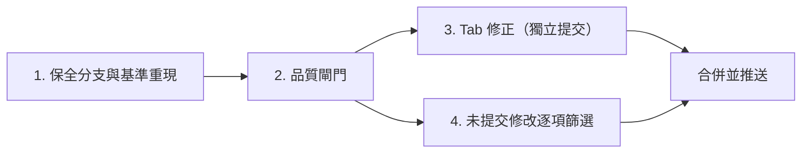

# 未提交修改分流與品質閘門交接文件

- **撰寫日期**：2026-10-31
- **依據**：第三輪審查實測（HEAD `dd8ea03` 與工作目錄未提交修改之比較）
- **交接對象**：新對話中的實作 Agent（Gemini 4 Argon）
- **前置文件**：[RUHI_EVALUATION_AND_CALIBRATION_HANDOVER.md](RUHI_EVALUATION_AND_CALIBRATION_HANDOVER.md)、[RUHI_LONGKAN_REVIEW_HANDOVER.md](RUHI_LONGKAN_REVIEW_HANDOVER.md)

> [!IMPORTANT]
> 開始前請先閱讀 `C:\ATGprjs\AGENTS.md`（尤其是「嚴禁單字權重打地鼠」、「.ps1 必須 UTF-8 BOM」、「禁止背景啟動 GUI」三節），再依本文件章節順序執行。每完成一個檢查點，回報原始數據後再進入下一節。

---

## 0. 背景與基準數據

第三輪審查發現：HEAD 品質穩定，但工作目錄中約兩天份的未提交修改（32 個已追蹤檔案、約 +26,000／−8,000 行，另有 2 個未追蹤檔案）使品質退步。

| 項目 | HEAD `dd8ea03` | 工作目錄（未提交） |
|---|---|---|
| `cargo test --release`（ruhi-core） | 151／151 通過 | 149 通過、10 項失敗 |
| 開發集 CER | **6.52%**（2,924 錯字／44,855 字） | 6.92%（3,104 錯字） |
| 開發集整句正確率 | 55.44% | 53.02% |

開發集分類 CER：

| 類別 | HEAD | 工作目錄 |
|---|---|---|
| `civic_public` | 4.95% | 5.61% |
| `daily_dialogue` | 5.20% | 5.75% |
| `literary_narrative` | 6.76% | 7.19% |
| `moe_idiom_context` | 5.15% | 5.55% |
| `tech_doc` | 11.68% | 11.54% |

工作目錄中失敗的 10 項測試：

```
test_all_archaic_polyphonic_impostors_isolated
test_gan_en_na_jiu_shui_liang_jiao_hou_lai_chu_li
test_numerical_action_and_kaifachu_qita
test_longkan_v2_hsu_inline_tilde_tab_fusion_and_quicknum_261028
test_eight_homophone_pairs_in_contrasting_sentences_261019
test_user_troublesome_sentences
test_zhu_zai_and_compound_words_priority
test_user_three_pairs_plus_cheng_de_261031
test_shuru_zuowen_and_wenzi_jiuhui
test_twenty_one_homophone_confusion_pairs_261021
```

**根本原因**：針對個別句子新增規則與資料，卻未在提交前以 `ruhi_eval` 檢驗整體淨效益。本文件的目標是：

1. 保全未提交修改，讓主線回到可驗證的狀態；
2. 建立強制品質閘門，讓評測工具真正把關；
3. 以閘門逐項篩選未提交修改，只保留確實有益的部分。

---

## 1. 保全未提交修改，主線回到 HEAD

### 1.1 步驟

1. 確認 `docs/RUHI_LONGKAN_TECHNICAL_DISCLOSURE.md` 的 md5 仍為 `616f0fb1806eae6d1cc84468601c858d`。
2. 建立保全分支，並把**所有**未提交內容（含未追蹤檔案）提交到該分支：

   ```powershell
   cd C:\ATGprjs\ruhi
   git switch -c wip/2026-10-31-unreviewed
   git add -A -- . ":!docs/RUHI_WIP_TRIAGE_AND_QUALITY_GATE_HANDOVER.md"
   git commit -m "wip: preserve unreviewed changes as of 2026-10-31 (10 failing tests, dev CER 6.92%)"
   git switch main
   git add docs/RUHI_WIP_TRIAGE_AND_QUALITY_GATE_HANDOVER.md
   git commit -m "docs: add WIP triage and quality gate handover"
   ```

   - **本交接文件不可提交到保全分支**，否則切回 `main` 後會從工作目錄消失。上面的指令已將它排除，並在切回 `main` 後單獨提交。

   - 提交前確認沒有誤加 `longkan.bin`、DLL、`pending_revisions.json` 等不應入庫的檔案；若 `.gitignore` 漏列，先補 `.gitignore`。
   - 此分支**只保留在本機**，不推送到 GitHub，除非專案負責人另有指示。
3. 確認 `main` 工作目錄乾淨（`git status` 無修改），並重現基準：
   - `cargo test --release`（ruhi-core）151／151 通過；
   - `cargo run --release --bin ruhi_eval -- --set dev` 的 CER 為 6.52%。

   數據不符時，停下來回報，不要繼續。

### 1.2 恢復日常使用的 DLL

專案負責人目前日常打字使用的，可能是工作目錄版本建置的 DLL。請以 `main` 重新建置 `ruhi-tsf` 的 release 版本，並告知專案負責人執行 `hot_reload.ps1` 完成替換。

> [!CAUTION]
> 不得由 Agent 啟動任何 GUI 程式或在背景執行設定視窗；熱重載由專案負責人自行執行。

### 1.3 檢查點交付物

- 保全分支名稱與 commit 編號；
- `main` 上的測試與開發集 CER 重現結果。

---

## 2. 建立品質閘門

### 2.1 `ruhi_eval --gate`

在 `ruhi-core/src/bin/ruhi_eval.rs` 新增閘門模式：

```powershell
cargo run --release --bin ruhi_eval -- --gate --baseline ../eval_reports/dev_gate_baseline.json
```

1. **基準檔** `eval_reports/dev_gate_baseline.json`：只含彙總數字（整體 CER、整句正確率、各類別 CER、句數、字數、產生時的 commit 編號），**不含任何句子原文**，納入版本控制。第一版以 `main`（HEAD `dd8ea03`）的結果建立。
2. **逐句結果**另存於 `eval_reports/local/`（加入 `.gitignore`），只記錄句子編號與正誤，用於列出「修好／弄壞」的句子編號。
3. **判定規則**（任一條成立即失敗，程序結束碼非 0）：
   - 整體 CER 上升超過 **0.05** 個百分點；
   - 整句正確率下降超過 **0.30** 個百分點；
   - 任一類別 CER 上升超過 **0.30** 個百分點；
   - 弄壞的句數多於修好的句數。
4. **輸出**：基準值、本次值、差異、修好與弄壞的句數及編號、麥內瑪檢定 p 值、判定結果。

### 2.2 `scripts/quality_gate.ps1`

- 依序執行：`cargo test --release`（ruhi-core）→ `cargo build --release`（ruhi-tsf）→ `ruhi_eval --gate`。任一步失敗即中止，並顯示失敗原因。
- 檔案必須存為 **UTF-8 with BOM**。交付前執行原生語法檢查並確認零錯誤：

  ```powershell
  powershell.exe -NoProfile -ExecutionPolicy Bypass -Command "& { Get-Command -Syntax C:\ATGprjs\ruhi\scripts\quality_gate.ps1 }"
  ```

- 此腳本不需要系統管理員權限，**不得**加入 UAC 提權。

### 2.3 Git pre-commit hook

- 新增 `scripts/install_git_hooks.ps1`（UTF-8 BOM，同樣需語法檢查），安裝 `.git/hooks/pre-commit`。
- hook 檢查暫存區：若變更涉及下列「評分相關檔案」，就執行 `scripts/quality_gate.ps1`，失敗則拒絕提交：
  - `ruhi-core/src/router/**`
  - `ruhi-core/src/engine.rs`
  - `ruhi-core/src/lexicon/**`
  - `ruhi-core/src/fsm/**`
  - `ruhi_lexicon/data/*.tsv`、`ruhi_lexicon/data/*.jsonl`
- 其他變更只執行 `cargo test`（ruhi-core）。
- **Agent 一律不得使用 `git commit --no-verify` 繞過閘門。** 若確有必要，須先取得專案負責人同意，並在提交訊息中註明原因。

### 2.4 基準更新規則

- 只有在閘門通過**且** CER 下降時，才可更新 `dev_gate_baseline.json`，並與造成改善的修改放在同一個提交中。
- 測試集評估維持「每個發布版本一次」，只看彙總數字。

### 2.5 CONTRIBUTING.md

新增「品質閘門」一節，說明上述規則與安裝方式。

### 2.6 檢查點交付物

- `dev_gate_baseline.json` 內容；
- 對 `main` 執行 `quality_gate.ps1` 的完整輸出（應為通過）；
- 刻意加入一條會造成退步的測試規則時，閘門確實拒絕提交的輸出（驗證完畢後撤銷該規則）。

---

## 3. 龍龕模式 `Tab` 行為修正（獨立小提交）

專案負責人已決定：**輸入座為空時一律放行 `Tab`；龍龕詞彙模式只用 `-` 開啟。**

1. `ruhi-tsf/src/service.rs` 的 `OnTestKeyDown` 與 `OnKeyDown`：輸入座為空時，所有模式（含龍龕）都放行 `VK_TAB`，移除 `&& !is_longkan_mode` 的例外。
2. 輸入座**非空**時維持現行行為：`Shift + 方向鍵` 標記後按 `Tab` 進行事後部件融合、詞彙模式中按 `Tab` 送出、游標移至編碼開頭補按 `Tab` 轉為詞彙模式。
3. `ruhi-core/src/longkan/mod.rs`：空緩衝區收到 `\t` 時直接放行，不進入詞彙模式；`-` 維持可開啟詞彙模式。
4. 調整單元測試（例如 `\tceru\t` 改為 `-ceru\t`），並把 README、CHANGELOG、`docs/ruhi_interactive_workbench.html` 中「按 `Tab`（或 `-`）開啟詞彙模式」改為「按 `-` 開啟詞彙模式」。
5. **不要修改** `docs/RUHI_LONGKAN_TECHNICAL_DISCLOSURE.md`。
6. 以 `main` 為基礎單獨提交，並通過第 2 節的閘門。

**交由專案負責人手動驗證**（Agent 不得啟動 GUI）：在 Notepad++、瀏覽器表單與 LINE 中，切到龍龕模式後，空輸入座按 `Tab` 能正常縮排或切換焦點；事後部件融合仍可運作。

---

## 4. 未提交修改的逐項篩選

### 4.1 修改分組

| 組別 | 檔案 | 驗證方式 |
|---|---|---|
| A. 評分相關 | `router/constructions.rs`、`router/transitions.rs`、`router/viterbi.rs`、`engine.rs` 中影響選字的部分、`lexicon/manager.rs`、`fsm/hsu_fsm.rs`、`lexicon_domain.tsv`、`lexicon_mcbopomofo.tsv`、`lexicon_moe.tsv`、`transitions_user.tsv`、`patterns_user.jsonl` | 單元測試 + 閘門，**逐單位**移植 |
| B. 輸入行為與 TSF | `ruhi-tsf/src/*`、`cangjie/*`、`array30/mod.rs`、`engine.rs` 中按鍵處理的部分 | 單元測試 + 專案負責人手動驗證清單 |
| C. 語意調校工作室 | `ruhi-studio/**`（含未追蹤的 `http_client.rs`）、未追蹤的啟動腳本 `.ps1` | 編譯通過 + 功能說明 |
| D. 龍龕資料 | `longkan.tsv`、`scripts/build_longkan_tsv.py`、`longkan/table.rs` | 單元測試 + `ruhi_eval --mode longkan` 對照 `eval_reports/longkan_dev_baseline.json` |
| E. 其他 | `installer/*.example.json`、`scripts/hot_reload.ps1` | 逐項檢視 |

### 4.2 移植方法

1. 從 `main` 開分支 `triage/2026-10-31`。
2. 以 `git restore --source wip/2026-10-31-unreviewed -p <檔案>` 或 `git checkout -p wip/2026-10-31-unreviewed -- <檔案>`，**逐段**取回修改。
3. **A 組的移植單位**：一條規則、一個規則族，或一個資料區塊。每個單位各自執行 `quality_gate.ps1`：
   - 通過：提交，提交訊息註明 CER 變化與修好／弄壞的句數；
   - 不通過：捨棄該單位，記錄在報告中。
4. **B、C、E 組**：可依功能整批移植，但每批都需通過閘門（閘門會確認未影響 CER）。B 組另列手動驗證清單交專案負責人。
5. **D 組**：不要直接移植 `longkan.tsv` 的差異，而是先移植 `build_longkan_tsv.py` 的修改，再以腳本重新產生 `longkan.tsv`，用 `ruhi_lkbin` 產生 `.bin`，以龍龕評測（Top-1、KSPC、平均候選位次）對照基準。不得變差。

### 4.3 必須遵守的規則

- **新規則**的分數絕對值不得超過 35；不得新增不依賴前文的特定詞加減分（例如 `prev_word == "某詞"` 就一律加分）。
- **詞庫資料**：工作目錄把部分罕用字（如「㡳、埅、埊、嶳」）的單字權重改為 1，這屬於單字權重調整。請改用既有的 `rejected_readings.tsv` 帳本處理罕用讀音，不要直接改寫詞庫權重。
- **新增的使用者句子測試**（例如 `test_user_three_pairs_plus_cheng_de_261031`）：連同對應規則一起移植。若規則無法通過閘門，測試改為 `#[ignore = "known hard case: 原因"]`，並記入 `docs/KNOWN_HARD_CASES.md`（列出輸入、預期、實際、嘗試過的做法與閘門數據）。**不得為了讓測試通過而加入會使整體退步的規則。**
- 既有的 151 項測試不得改為 `#[ignore]`，也不得修改其預期值，除非取得專案負責人同意。

### 4.4 交付報告

產出 `docs/WIP_TRIAGE_REPORT_20261031.md`，內容包括：

| 欄位 | 說明 |
|---|---|
| 單位 | 檔案與修改摘要 |
| 組別 | A～E |
| 決定 | 保留／捨棄／列為困難案例 |
| CER 變化 | 移植前後的開發集 CER |
| 修好／弄壞 | 句數 |
| 備註 | 捨棄原因等 |

並附上篩選完成後的最終數據：測試通過數、開發集 CER、各類別 CER、龍龕 Top-1 與 KSPC。

### 4.5 收尾

- `triage/2026-10-31` 經專案負責人確認後合併回 `main` 並推送。
- `wip/2026-10-31-unreviewed` 保留，**刪除前須取得專案負責人同意**。

---

## 5. 禁止事項

1. 不得讀取 `ruhi_lexicon/eval/test.tsv` 的句子內容。
2. 不得使用 `git commit --no-verify`，或以其他方式繞過品質閘門。
3. 不得修改 `docs/RUHI_LONGKAN_TECHNICAL_DISCLOSURE.md`。
4. 不得直接調整單字無上下文權重；不得新增分數絕對值超過 35 的規則。
5. 不得刪除保全分支，不得改寫已推送的 Git 歷史。
6. 不得由 Agent 啟動 GUI 程式；需要人工驗證的項目，一律整理成清單交給專案負責人。
7. 回報時一律附上原始數據，並對照本文件的**原始驗收標準**，不得以替代指標代換。

---

## 6. 執行順序與檢查點



| 檢查點 | 交付物 |
|---|---|
| 第 1 節 | 保全分支 commit 編號；`main` 的測試結果與 CER 6.52% 重現 |
| 第 2 節 | 基準檔內容；閘門通過與攔截兩種情況的輸出；`.ps1` 語法檢查結果 |
| 第 3 節 | commit 編號；閘門輸出；手動驗證清單 |
| 第 4 節 | `WIP_TRIAGE_REPORT_20261031.md`；最終數據；B 組手動驗證清單 |

---

## 7. 後續事項（本次不執行）

以下為第三輪審查的其他建議，待本文件完成後由專案負責人決定是否展開：

1. **凍結新輸入模式**，直到核心 CER 明顯下降。
2. **重做分數校準**：目前 `feature_weights.tsv` 的 18 個權重倍數全部介於 0.91～1.08，校準實際上沒有改變分數。需補充一般性語料（目前開發集以宗教哲學譯本為主），並檢討學習率與特徵粒度。
3. **TSF 健壯性**：`service.rs` 的 284 處 `lock().unwrap()` 改為可從 Mutex 中毒狀態復原的寫法；主詞庫比照龍龕改用 mmap（目前每個程序約 280 MB、初始化約 0.9 秒）。
4. **清理既有規則**：分數絕對值 ≥ 40 的 84 條規則，以及 21 處不依賴前文的特定詞加減分，逐一以消融分析檢驗。
